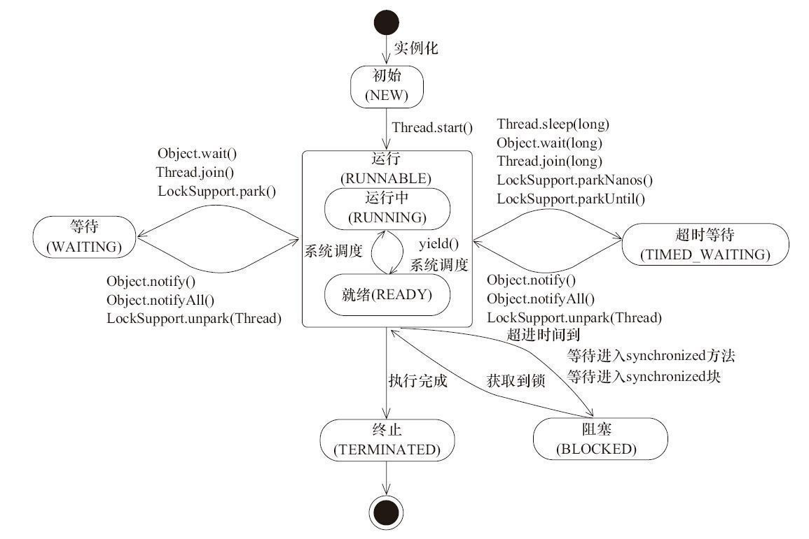

# Java 线程的使用

进程是资源分配的最小单位，线程是 CPU 调度的最小单位；一个进程可以包含多个线程，各线程共享进程资源、并发执行各自的任务。

## 线程的状态与生命周期

`java.lang.Thread.State` 定义了线程的 6 种状态：

- 新建（NEW）：线程对象已创建，尚未调用 `start()`。
- 可运行（RUNNABLE）：已启动，等待或正在获得 CPU 执行；Java 不区分就绪和运行中。
- 阻塞（BLOCKED）：等待进入 `synchronized` 保护的代码，等待监视器锁。
- 等待（WAITING）：无限期等待其他线程唤醒，如调用 `wait()`、`join()`、`LockSupport.park()`。
- 超时等待（TIMED_WAITING）：带超时的等待，超时后自动唤醒，如 `sleep()`、`wait(timeout)`、`join(timeout)`。
- 终止（TERMINATED）：`run()` 执行完毕。

## 创建与启动线程

通常说的定义线程任务的方式有三种：继承 `Thread`、实现 `Runnable`、实现 `Callable`。`Callable` 的任务需借助 `FutureTask` 包装或提交给线程池来运行。

启动线程调用 `start()`，JVM 会创建新线程并在其中执行 `run()`；直接调用 `run()` 只在当前线程里普通地执行方法体，不产生新线程。

每个线程有一个 id 和一个 name。id 是递增整数，每创建一个线程加一；name 默认为 "Thread-" 加编号，可在构造方法或 `setName()` 中指定。

## 常用线程方法

- `run()` / `call()`：定义线程的任务体，`call()` 可以返回结果。
- `start()`：启动线程，随后由新线程调用 `run()`。
- `Thread.sleep(long millis)`：当前线程进入 TIMED_WAITING，不释放对象锁，到时间后回到 RUNNABLE，期间让出 CPU。
- `Object.wait()`：释放对象锁，进入该对象的等待队列，需其他线程调用 `notify()` / `notifyAll()` 唤醒。
- `Object.wait(long timeout)`：同上，但超时后自动唤醒，不依赖通知。
- `Object.notify()` / `notifyAll()`：唤醒该对象等待队列中的线程。
- `thread.join()` / `thread.join(long millis)`：让当前线程等待目标线程结束，可带超时。
- `Thread.yield()`：当前线程让出 CPU，回到可运行状态，由 OS 重新调度，调度器可以忽略这次让出。
- `LockSupport.park()` / `unpark(Thread thread)`：阻塞当前线程 / 唤醒指定线程，不要求持有对象锁。

## 线程优先级

Java 线程优先级取值为 1（`Thread.MIN_PRIORITY`）到 10（`Thread.MAX_PRIORITY`），默认 5（`Thread.NORM_PRIORITY`）。值越大获得运行的机会越大，但调度不严格遵守优先级，相同优先级下大体按 FIFO，都不能保证。

各操作系统的优先级数量和语义并不一致，Java 的优先级最终映射到 OS 调度，效果无法跨平台依赖。常见的做法是只用三个常量表达优先级意图，不把程序正确性建立在优先级之上。

## 共享变量的同步问题

多线程共享内存会遇到两类问题：多个线程竞争访问同一数据，以及一个线程的修改对另一个线程不可见。

Java 中每个线程有自己的工作内存，普通变量的读写先作用于工作内存，再与主内存同步。围绕这一模型，有三种常用的同步手段：

- `synchronized`：保证代码块在任一时刻最多一个线程执行。实例方法保护的是当前实例对象（this），每个对象有一个锁和一个等待队列，锁同时只能被一个线程持有，其余线程在队列中等待。
- `volatile`：强制对变量的读写直接作用于主内存，保证可见性；同时禁止赋值前后的指令重排序。它只解决可见性，不解决复合操作的原子性。
- CAS（Compare and Swap）：JDK 提供的非阻塞原子操作，由硬件保证"比较并交换"的原子性。修改主内存变量时先比较当前值与预期值，一致才写入，否则本次不生效，由调用方决定重试。
