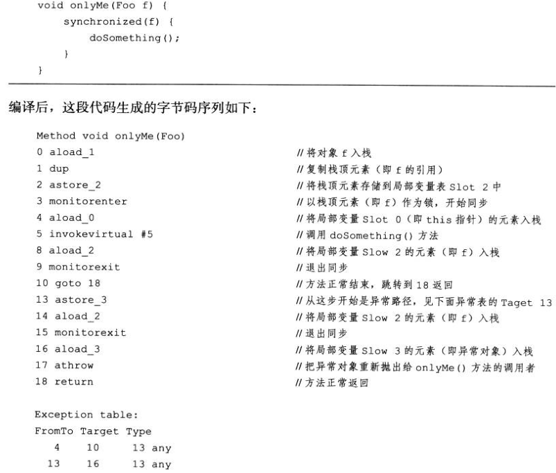

# JVM 字节码详解

JVM 的作用是加载编译器编译好的 Class 文件，把其中的字节码解释（或即时编译）为机器码后执行。Class 文件中包含 JVM 指令集、符号表和其他辅助信息，方法内的代码保存在 code 属性中，方法体里的字节码指令序列就是该方法的执行逻辑。

JVM 规范对 Class 文件规定了强制性的语法和结构化约束，任何语言只要编译出 JVM 认可的有效 Class 文件，就能加载到 JVM 中运行。

JVM 采用面向操作数栈而非寄存器的架构，大多数指令不含操作数，只有一个操作码。面向栈的指令易于移植、编码紧凑；面向寄存器的指令直接依赖硬件，执行速度更快、完成同一操作所需指令更少。

## 字节码指令简介

字节码指令集编码短小、便于传输、可跨平台，代价是解释执行效率有所损失。

- 指令由操作码 + 操作数组成。操作码（Opcode）是一个字节长度、代表特定操作的数字，其后跟随零至多个操作数（Operands），表示操作所需的参数。
- 操作码只有一字节，指令总数不超过 256 条。这是 JVM 为换取短小紧凑的编译代码做出的设计取舍。
- 操作数长度不对齐。长度超过 1 字节的操作数按 big-endian（高位在前）存储，例如两个无符号字节表示的值是 `(byte1 << 8) | byte2`。不对齐可以省去大量填充字节。
- 字节码指令流按单字节对齐，只有 tableswitch 和 lookupswitch 两个指令例外：它们以 4 字节为界对齐，不足处补 0。

操作码是一字节长的 8 位二进制数，也就是两位十六进制数。它在 Class 文件中以数字形式存在，并有对应的助记符形式（如 0x60 对应 iadd）。

指令的设计是逻辑功能与数据类型的组合。

## 指令支持的数据类型

JVM 指令集中，大多数指令的助记符都体现了所操作的数据类型。

数据类型由助记符首字母标识：i 表示 int，l 表示 long，s 表示 short，b 表示 byte，c 表示 char，f 表示 float，d 表示 double，a 表示引用（reference）。

指令集并未覆盖所有数据类型。byte、short、char、boolean 统一按运算类型（computational type）为 int 的指令处理：byte 和 short 带符号扩展（sign-extend）为 int，boolean 和 char 零位扩展（zero-extend）为 int。

## 指令集

JVM 指令集按用途可分为九类。

- **加载和存储指令**：在局部变量表与操作数栈之间传送数据，或把常量压入操作数栈，如 push、load、store、const。这类指令按数据类型在助记符前加 i/l/f/d/a 前缀；操作数为 0~3 时以下划线形式附在指令后（如 iload_3），大于等于 4 时作为独立操作数跟在指令后（如 iload 4）。
- **运算指令**：加 add、减 sub、乘 mul、除 div、求余 rem、取反 neg、移位 sh（l 左移、r 右移）、按位与 and、按位或 or、异或 xor、自增 inc、比较 cmp。
- **类型转换指令**：`<T>2<T>` 形式，表示从操作类型转换到目标类型。小范围类型转大范围类型是宽化类型转换，反之是窄化类型转换。
- **对象创建与访问指令**：创建对象 new、创建基本类型数组 newarray、创建引用类型数组 anewarray、创建多维数组 multianewarray，以及访问字段和数组元素的指令（getfield、putfield、getstatic、putstatic、xaload、xastore 等）。
- **操作数栈管理指令**：出栈 pop、交换栈顶两个值 swap、复制栈顶并压栈 dup。
- **控制转移指令**：条件跳转由 if 与 eq/ne/lt/le/gt/ge 组合，与 0 比较用 `if<cond>`，比较栈顶两个操作数用 `if_icmp<cond>`；复合条件跳转 tableswitch、lookupswitch；无条件跳转 goto。
- **方法调用和返回指令**：调用实例方法 invokevirtual、调用接口方法 invokeinterface、调用特殊实例方法 invokespecial（如构造方法）、调用静态方法 invokestatic、调用动态链接方法 invokedynamic；返回指令 return（按返回类型加 i/l/f/d/a 前缀）。jsr、ret 在 JDK 6 起已被弃用。
- **异常处理指令**：显式抛出异常 athrow，catch 分支由方法的异常表配合完成。
- **同步指令**：monitorenter、monitorexit。

### 助记符速查表

| 助记符 | 英文 | 含义 |
| ------ | ---- | ---- |
| push | push | 将一个立即数压入操作数栈 |
| load | load | 将一个局部变量加载到操作数栈 |
| const | const | 将一个常量加载到操作数栈 |
| store | store | 将一个数值从操作数栈存储到局部变量表 |
| add | add | 加法 |
| sub | subtract | 减法 |
| mul | multiply | 乘法 |
| div | divide | 除法 |
| inc | increment | 自增 |
| rem | remainder | 取余 |
| neg | negate | 取反 |
| sh | shift | 移位 |
| and | and | 按位与 |
| or | or | 按位或 |
| xor | exclusive OR | 按位异或 |
| 2 | to | 类型转换 |
| cmp | compare | 比较 |
| return | return | 返回 |
| eq | equal | 相等 |
| ne | not equal | 不相等 |
| lt | less than | 小于 |
| le | less than or equal | 小于等于 |
| gt | greater than | 大于 |
| ge | greater than or equal | 大于等于 |
| if | if | 条件判断 |
| goto | goto | 跳转 |
| invoke | invoke | 调用 |
| dup | duplicate | 复制栈顶并压栈 |

## 字节码示例

一个方法的源代码与其编译后的字节码对照如下。

