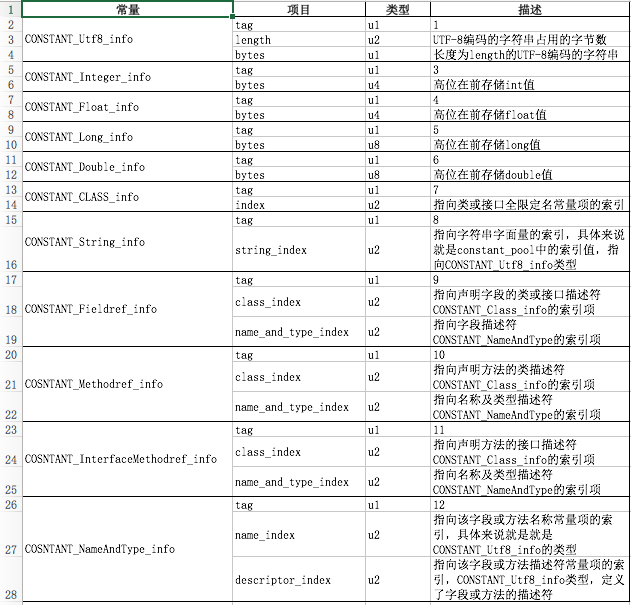

# JVM 中的 class 文件结构

Java 源代码经 javac 编译为 class 文件后交给 JVM 执行。JVM 不仅平台无关，而且语言无关：无论上层语言是 Java 还是 Kotlin，JVM 只认识 class 文件，只要文件符合规范就能运行。可以说，class 文件是 JVM 运行的基石。

## class 文件中的数据类型

class 文件是二进制文件，内容遵循严格规范，没有空格和分隔符，全部是连续的字节。文件中的数据只有两种组织形式：无符号数和表。

- **无符号数**：基本数据类型，按字节数分为 u1、u2、u4、u8 四种，分别表示 1、2、4、8 字节的无符号数。无符号数可表示数字、索引引用、数量值或 UTF-8 编码的字符串。
- **表**：由多个无符号数或其他表组成的复合数据类型，用于描述有层次关系的结构，类型名都以 `_info` 结尾。常量池项、字段、方法、属性等都使用表来存放。

## class 文件的整体结构

class 文件按固定顺序依次存放以下部分：

- **魔数（magic）**：固定值 0xCAFEBABE，占开头 4 个字节，是 JVM 判断文件是否为 class 格式的依据。
- **版本号**：紧接着的 4 个字节依次为小版本号和主版本号。主版本号标记生成 class 文件的 JDK 版本，例如 52 对应 JDK 8，61 对应 JDK 17。高版本 JVM 可以运行低版本的 class 文件，反之会抛出 `UnsupportedClassVersionError`。
- **常量池**：版本号之后是常量池计数和常量池项。常量池类似一个数组，从 1 开始编号（0 号位置保留，Long 和 Double 项各占两个索引位置）。常量池几乎汇集了类中所有信息的描述，详细内容见下文。
- **访问标志（access_flags）**：2 个字节，标识该类是 public、final、interface、abstract 中的哪种，完整取值见附录。
- **类索引、父类索引与接口索引集合**：依次为 2 字节的 this_class、2 字节的 super_class、2 字节的 interfaces_count，其后是 interfaces_count 个 2 字节接口索引，它们都指向常量池中的 CONSTANT_Class_info 项。
- **字段表、方法表与属性表**：依次为字段表、方法表和类级别的属性表。每张表前 2 个字节是表项个数，其后是对应数量的表项。字段表与方法表的结构相似，每个字段和方法还可以携带自己的属性集合，如方法的字节码 Code 属性。

## 常量池

常量池存放字符串、final 常量值、当前类的类名、字段名、方法名、各字段和方法的描述符、对本类字段和方法的引用、对其他类的引用等。class 文件的许多部分都是对常量池数据项的引用：this_class、super_class、字段表、属性表中的索引指向常量池，字节码指令也把常量池索引作为操作数，常量池的各项之间还会互相引用。

常量池中的常量分为两大类：字面量（Literal）和符号引用（Symbolic References）。

- **字面量**：字符串、被声明为 final 的常量值等。
- **符号引用**：类和接口的全限定名、字段的名称和描述符、方法的名称和描述符。

常量池的每一项都是一个表，表的开头是一个 u1 类型的 tag 标志位，标识该项的类型。class 文件格式最初定义了以下 11 种常量类型：

| 类型 | 标志（tag） | 描述 |
| ---- | ----------- | ---- |
| CONSTANT_Utf8_info | 1 | UTF-8 编码的字符串 |
| CONSTANT_Integer_info | 3 | 整型字面量，boolean、byte、char、short 等类型的值也用 int 存放 |
| CONSTANT_Float_info | 4 | 浮点型字面量 |
| CONSTANT_Long_info | 5 | 长整型字面量 |
| CONSTANT_Double_info | 6 | 双精度浮点型字面量 |
| CONSTANT_Class_info | 7 | 类或接口的符号引用 |
| CONSTANT_String_info | 8 | 字符串类型字面量 |
| CONSTANT_Fieldref_info | 9 | 字段的符号引用 |
| CONSTANT_Methodref_info | 10 | 类中方法的符号引用 |
| CONSTANT_InterfaceMethodref_info | 11 | 接口中方法的符号引用 |
| CONSTANT_NameAndType_info | 12 | 字段或方法的名称和描述符 |

Java 7 起陆续新增了 CONSTANT_MethodHandle_info、CONSTANT_MethodType_info、CONSTANT_InvokeDynamic_info，Java 9 新增 CONSTANT_Module_info 和 CONSTANT_Package_info，目前规范共定义 17 种常量类型。

## 附录

### class 文件内容格式

| 类型 | 描述 | 备注 |
| ---- | ---- | ---- |
| u4 | magic | 魔数：0xCAFEBABE |
| u2 | minor_version | 小版本号 |
| u2 | major_version | 主版本号 |
| u2 | constant_pool_count | 常量池大小，从 1 开始 |
| cp_info | constant_pool[constant_pool_count - 1] | 常量池信息 |
| u2 | access_flags | 访问标志 |
| u2 | this_class | 类索引 |
| u2 | super_class | 父类索引 |
| u2 | interfaces_count | 接口个数 |
| u2 | interfaces[interfaces_count] | 接口类索引信息 |
| u2 | fields_count | 字段数 |
| field_info | fields[fields_count] | 字段表信息 |
| u2 | methods_count | 方法数 |
| method_info | methods[methods_count] | 方法表信息 |
| u2 | attributes_count | 属性个数 |
| attribute_info | attributes[attributes_count] | 属性表信息 |

### 常量池全景表

### 类、字段、方法的访问标志

同一个标志在不同位置（类、字段、方法）的合法性不同，下表是常见的取值：

| 标志名称 | 标志值 | 含义 |
| -------- | ------ | ---- |
| ACC_PUBLIC | 0x0001 | 是否为 public |
| ACC_PRIVATE | 0x0002 | 是否为 private |
| ACC_PROTECTED | 0x0004 | 是否为 protected |
| ACC_STATIC | 0x0008 | 是否为 static |
| ACC_FINAL | 0x0010 | 是否为 final，类、方法、字段均可设置 |
| ACC_SUPER | 0x0020 | JDK 1.0.2 之后编译的类都会设置该标志 |
| ACC_VOLATILE | 0x0040 | volatile 字段，不可与 ACC_FINAL 同时设置 |
| ACC_TRANSIENT | 0x0080 | 序列化时被忽略的字段 |
| ACC_NATIVE | 0x0100 | native 方法 |
| ACC_INTERFACE | 0x0200 | 是否为接口 |
| ACC_ABSTRACT | 0x0400 | 是否为 abstract（接口或抽象类） |
| ACC_SYNTHETIC | 0x1000 | 该类、字段或方法并非由用户代码产生 |
| ACC_ANNOTATION | 0x2000 | 是否为注解 |
| ACC_ENUM | 0x4000 | 是否为枚举 |

### 字段、方法信息结构

| 类型 | 描述 | 备注 |
| ---- | ---- | ---- |
| u2 | access_flags | 字段、方法的访问标志 |
| u2 | name_index | 常量池索引，指向字段、方法的名称 |
| u2 | descriptor_index | 常量池索引，指向字段、方法的描述符 |
| u2 | attributes_count | 属性表中包含的项目数 |
| attribute_info | attributes[attributes_count] | 字段、方法的属性 |

name_index 指向常量池中的简单名称，descriptor_index 指向描述符。描述符用来描述字段的数据类型，以及方法的参数列表（数量、类型和顺序）与返回值。

描述符的标识字符：

| 标识字符 | 含义 |
| -------- | ---- |
| B | 基本类型 byte |
| C | 基本类型 char |
| D | 基本类型 double |
| F | 基本类型 float |
| I | 基本类型 int |
| J | 基本类型 long |
| S | 基本类型 short |
| Z | 基本类型 boolean |
| V | 特殊类型 void |
| L | 对象类型，如 Ljava/lang/Object; |
| [ | 数组类型，多个维度则写多个 [ |

方法表的结构与字段表完全相同。

### 属性信息结构

不同属性有不同的数据结构，属性中还可以嵌套其他属性。其中 Code 属性存放方法编译后的字节码指令序列，是 class 文件的核心数据。

常见属性及使用位置：

| 属性名称 | 使用位置 | 含义 |
| -------- | -------- | ---- |
| Code | 方法表 | Java 代码编译成的字节码指令 |
| ConstantValue | 字段表 | final 关键字定义的常量值 |
| Deprecated | 类文件、方法表、字段表 | 被声明为 deprecated 的方法和字段 |
| Exceptions | 方法表 | 方法抛出的异常 |
| InnerClasses | 类文件 | 内部类列表 |
| LineNumberTable | Code 属性 | Java 源码行号与字节码指令的对应关系 |
| LocalVariableTable | Code 属性 | 方法的局部变量描述 |
| SourceFile | 类文件 | 源文件名称 |
| Synthetic | 类文件、方法表、字段表 | 标识方法或字段为编译器自动生成 |

Code 属性的数据结构：

| 类型 | 名称 | 含义 |
| ---- | ---- | ---- |
| u2 | attribute_name_index | 属性名称索引 |
| u4 | attribute_length | 属性长度 |
| u2 | max_stack | 操作数栈深度的最大值 |
| u2 | max_locals | 局部变量表所需的存储单元数 |
| u4 | code_length | 字节码长度 |
| u1 | code[code_length] | 存储字节码指令的一系列字节流 |
| u2 | exception_table_length | 异常表长度 |
| exception_info | exception_table | 异常处理表，即 try-catch 区域 |
| u2 | attributes_count | 子属性个数 |
| attribute_info | attributes[attributes_count] | 子属性表，如 LineNumberTable、LocalVariableTable |
