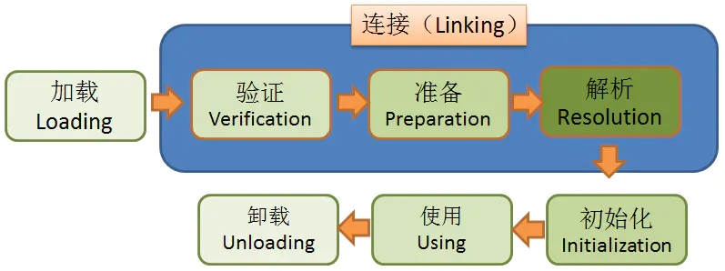
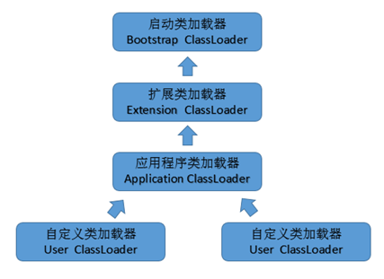

# JVM 类加载与类加载器

虚拟机的类加载机制负责把 class 文件加载到内存，经过校验、转换解析和初始化，最终形成可以被虚拟机直接使用的 Java 类型。类的生命周期包括加载、链接、初始化、使用、卸载五个阶段，其中链接又包含验证、准备、解析三步。

## 类加载的时机

严格地说，这里触发的是类的初始化，加载通常在此之前完成。《Java 虚拟机规范》明确规定，有且只有以下六种"主动引用"会触发类的初始化：

- 使用 new 关键字实例化对象，读取或设置一个类的静态字段（编译期确定的常量除外），或调用一个类的静态方法；
- 使用 java.lang.reflect 反射对类进行调用时，如果类尚未初始化，则先触发其初始化；
- 初始化一个类时，如果其父类尚未初始化，则先触发父类的初始化；
- 虚拟机启动时，需要先初始化用户指定的主类（包含 main() 方法的类）；
- 使用 JDK 1.7 的动态语言支持时，如果一个 java.lang.invoke.MethodHandle 实例最后的解析结果是 REF_getStatic、REF_putStatic、REF_invokeStatic 的方法句柄，且对应的类尚未初始化，则先触发其初始化；
- 当一个接口中定义了 JDK 8 加入的默认方法（default 方法）时，如果该接口的实现类发生初始化，则该接口需要在其之前被初始化。

除主动引用之外，其余所有引用类的方式都不会触发初始化，称为"被动引用"。常见的三种情况：

- 通过子类引用父类的静态字段，只会触发父类的初始化，不会触发子类的初始化；
- 定义类的数组（如 SuperClass[] arr = new SuperClass[10]）不会触发 SuperClass 的初始化；
- 引用编译期即可确定的常量，不会触发定义该常量的类的初始化。

## 类加载的过程

### 加载（Loading）

加载是类加载过程的第一步。这一阶段，类加载器（ClassLoader）主要完成三件事：

- 通过一个类的全限定名获取定义此类的二进制字节流，来源可以是 Jar 包、目录、网络等，不限于本地文件；
- 将字节流所代表的静态存储结构转换为方法区的运行时数据结构；
- 在堆中生成一个代表该类的 java.lang.Class 对象，作为方法区中这些数据的访问入口。

### 链接（Linking）

链接把已经读入内存的二进制数据合并到虚拟机的运行时环境中，包含验证、准备、解析三步。

- **验证（Verification）**：确保 class 文件的字节流中包含的信息符合当前虚拟机的要求，不危害虚拟机自身的安全。验证内容包括：class 文件格式规范、字节码描述的元数据规范、字节码中数据流和控制流的合法性与逻辑性、符号引用。
- **准备（Preparation）**：为类的静态变量分配内存并设置零值。这里设置的是各数据类型的默认零值，代码中显式指定的值要到初始化阶段才执行。
- **解析（Resolution）**：把常量池中的符号引用替换为直接引用。符号引用是用一组符号描述所引用的目标，与内存布局无关；直接引用是指向目标的指针、相对偏移量或间接定位句柄。符号引用共有类或接口、字段、类方法、接口方法、方法类型、方法句柄、调用点限定符七类。解析并不严格排在初始化之前，虚拟机实现可以推迟到初始化之后再进行，以支持 Java 的运行时绑定。

### 初始化（Initialization）

初始化阶段才真正执行类中定义的 Java 程序代码：为静态变量赋予代码中显式指定的值，并执行静态代码块。执行前先检查此类是否已加载、链接，未完成则先加载、链接；再检查其直接父类是否已初始化，未完成则先初始化父类；最后依次执行初始化语句。

### 使用（Using）与卸载（Unloading）

初始化完成后即可使用该类：类的类型信息存放在方法区，实例对象存放在堆中。

类可以被卸载，但条件苛刻：该类的所有实例都已被回收，加载该类的类加载器已被回收，且该类对应的 java.lang.Class 对象没有任何地方被引用。由启动类加载器加载的核心类（如 java.lang.Object）在虚拟机生命周期内不会被卸载；由用户自定义类加载器加载的类，在其类加载器被回收后即可卸载，这也是自定义类加载器实现类替换与"热部署"的基础。

## 类加载器

类加载器负责加载类，为每个载入内存的类生成一个 java.lang.Class 实例。类在虚拟机中的唯一标识由全限定类名和加载它的类加载器共同决定：同一个 class 文件，由不同的类加载器加载，在虚拟机中也是两个不同的类。

JVM 预定义了三种类加载器，虚拟机启动时由它们分工加载不同来源的类：

| 类加载器 | 实现 | 加载范围 |
| --- | --- | --- |
| 启动类加载器（Bootstrap） | C/C++ 实现，内嵌于 JVM 内部，不是 java.lang.ClassLoader 的子类，也没有父加载器，Java 程序无法直接操作 | JDK 核心类库：JDK 8 及之前为 <JAVA_HOME>/lib 下的类库（rt.jar 等）及 -Xbootclasspath 指定的路径，JDK 9 起为模块化的系统模块（如 java.base） |
| 扩展类加载器（Extension） | JDK 8 及之前为 sun.misc.Launcher$ExtClassLoader，父加载器为启动类加载器；JDK 9 起扩展机制被移除，由 jdk.internal.loader.ClassLoaders$PlatformClassLoader 取代 | JDK 8 及之前为 jre/lib/ext 目录和系统属性 java.ext.dirs 指定的目录下的类库 |
| 应用程序类加载器（Application） | JDK 8 及之前为 sun.misc.Launcher$AppClassLoader，JDK 9 起为 jdk.internal.loader.ClassLoaders$AppClassLoader，又称系统类加载器 | Java 命令的 -classpath 选项、java.class.path 系统属性或 CLASSPATH 环境变量指定的类库；是用户自定义类加载器的默认父加载器，可通过 ClassLoader.getSystemClassLoader() 获取 |

## 双亲委派模型

三种预定义类加载器之间的协作方式称为双亲委派模型，要点如下：

- **层级结构**：类加载器按父子关系组织，启动类加载器在最上层，其余加载器都有父加载器。
- **委派过程**：一个类加载器收到加载请求时，先把请求委派给父加载器，每层如此递归；只有当父加载器反馈自己无法完成加载（在搜索范围内找不到该类）时，子加载器才尝试自己加载。
- **可见性**：子加载器加载的类可以看到父加载器加载的类，反之不行，因此父加载器加载的核心类无法引用子加载器加载的类。
- **隔离性**：同一个类由不同加载器加载，在虚拟机中互不相同，两个类的实例之间无法相互强制类型转换，转换会抛出 ClassCastException。
- **唯一性**：由于委派机制的存在，java.lang.Object 等核心类无论由哪个加载器发起加载，最终都委派给启动类加载器，保证核心类在虚拟机中只有一份，防止 classpath 中出现同名类时被顶替。
