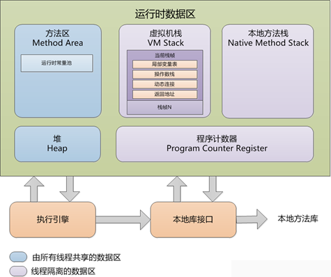
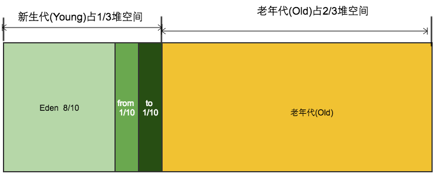

# JVM 运行时数据区

JVM 内存结构指 Java 虚拟机规范为程序运行划分的数据区域，规范中称为"运行时数据区"（Run-Time Data Areas）。规范只定义这些区域的用途和行为，具体实现允许存在差异，方法区的差异尤其明显；采用不同垃圾回收器时，堆的划分和管理方式也不相同。

数据区域主要包括程序计数器、Java 虚拟机栈、本地方法栈、Java 堆、方法区，以及规范之外的直接内存。

| 数据区域 | 线程共享 | 可能抛出的异常 |
| --- | --- | --- |
| 程序计数器 | 否 | 无 |
| Java 虚拟机栈 | 否 | StackOverflowError、OutOfMemoryError |
| 本地方法栈 | 否 | StackOverflowError、OutOfMemoryError |
| Java 堆 | 是 | OutOfMemoryError |
| 方法区 | 是 | OutOfMemoryError |
| 直接内存 | 否（进程级） | OutOfMemoryError |

> 不同虚拟机实现细节不同。以 HotSpot 为例：JDK 8 起方法区由堆外的元空间（Metaspace，本地内存）实现，JDK 7 及之前是永久代（非堆区域）。
>
> 另一个容易混淆的概念是 Java 内存模型（JMM，Java Memory Model）：它是一组规定多线程之间如何通过共享内存通信的规则，解决的是并发可见性问题，与本文讨论的内存结构不是一回事。

## 线程私有的数据区域

### 程序计数器

程序计数器（Program Counter Register）是一块较小的线程私有内存，可看作当前线程所执行字节码的行号指示器。

- 执行 Java 方法时，记录正在执行的字节码指令地址，通过改变它的值来选取下一条需要执行的指令。
- 线程上下文切换后，依靠程序计数器恢复到正确的执行位置。
- 执行 native 方法时，计数器值为空（Undefined）。

程序计数器是规范中唯一没有规定任何 OutOfMemoryError 情况的区域。

### Java 虚拟机栈

虚拟机栈为每个线程维护一个独立的栈空间，空间不必连续，生命周期与线程一致：线程创建时建立，线程结束时销毁。每个方法执行的同时都会创建一个栈帧并入栈，方法调用结束则出栈。

栈帧（Stack Frame）是记录一次方法调用的数据结构，包含：

- 局部变量表：存储方法参数和局部变量，最小单位是容量槽（slot），空间大小在编译期确定，运行期不会改变。
- 操作数栈：方法执行的工作区，存储计算中间结果，字节码指令在执行过程中不断向其中写入和读出数据（入栈/出栈）。
- 动态链接：指向运行时常量池中该栈帧所属方法的符号引用，用于支持方法调用过程中的动态连接。
- 返回地址：本方法执行完毕后下一条指令的地址。方法正常退出时取调用者的程序计数器值；异常退出时由异常处理器确定。
- 附加信息：规范未描述、由具体虚拟机自行决定的信息。

动态链接、返回地址、附加信息通常统称为栈帧信息。

两种异常：

- 线程请求的栈深度超过虚拟机允许的最大容量，抛出 StackOverflowError。
- 没有足够的内存为新线程创建虚拟机栈，抛出 OutOfMemoryError。

### 本地方法栈

作用与 Java 虚拟机栈类似，但它是 native 方法的工作空间。线程调用 native 方法时，Java 虚拟机栈保持不变，由动态链接转入本地方法栈执行。

规范并未强制规定本地方法栈的使用方式、实现语言和栈帧结构。HotSpot 选择将虚拟机栈与本地方法栈合并实现，因此两种栈的异常行为相同：StackOverflowError 和 OutOfMemoryError。

## 线程共享的数据区域

### Java 堆

Java 堆（Heap）在虚拟机启动时创建，是所有线程共享的最大一块内存区域，也称"GC 堆"。它存放对象实例和数组，是垃圾收集器管理的主要区域。

以 HotSpot 默认的分代布局为例：新生代与老年代的比例为 1:2，新生代内部 Eden 与 Survivor 按 8:2 划分，两块 Survivor（From、To）各占 1 份且始终相等。

- Eden：绝大多数对象在此创建。Minor GC 采用复制算法，回收后将存活对象复制到 From 区。
- Survivor：下一次 GC 时，From 区存活对象复制到 To 区，随后 From 与 To 互换角色，原空区成为新的 To。对象每熬过一次 Minor GC 年龄加一。
- 老年代（Old）：Survivor 中默认复制 15 次（受 MaxTenuringThreshold 和动态年龄判定影响）仍存活的对象晋升至此；大对象也可能直接分配在老年代。老年代空间不足时触发 Major GC（老年代回收），很多情况下伴随整堆回收，即 Full GC。

> 逃逸分析确认不会逃逸的对象可以直接在栈上分配（或经标量替换消除），不占用堆内存。
>
> 各区域比例均可通过参数调整：
> - -XX:NewRatio=n：新生代与老年代的比例（默认 1:2）。
> - -XX:SurvivorRatio=n：Eden 与单个 Survivor 的比例（From/To 恒为 1:1）。
> - -Xms / -Xmx：堆的最小值与最大值。

使用 G1 收集器时，堆被均分为大小相等的 Region（区域），逻辑上仍有 eden、survivor、old，各代由一个或多个不连续的 Region 组成，另设 Humongous 区存放超过 Region 一半大小的巨型对象。

### 方法区

与 Java 堆一样线程共享。规范没有规定它是一个真正独立的区域，各虚拟机可以自由选择实现方式。方法区存储已被虚拟机加载的类信息、常量、静态变量、即时编译器编译后的代码等数据，运行时常量池也是方法区的一部分。

> HotSpot 在 JDK 7 及之前用永久代实现方法区，JDK 8 起改为堆外的元空间（Metaspace），存储内容也有细微差别：字符串常量池和类静态变量在 JDK 7 已移入 Java 堆。

## 直接内存

直接内存也叫堆外内存，不是运行时数据区的一部分，不受 -Xmx 等堆参数约束。NIO 通过 DirectByteBuffer（底层调用 Unsafe.allocateMemory）使用直接内存，可避免 Java 堆与本地内存之间的数据复制，提升 IO 效率；分配超出机器内存上限时同样抛出 OutOfMemoryError。
