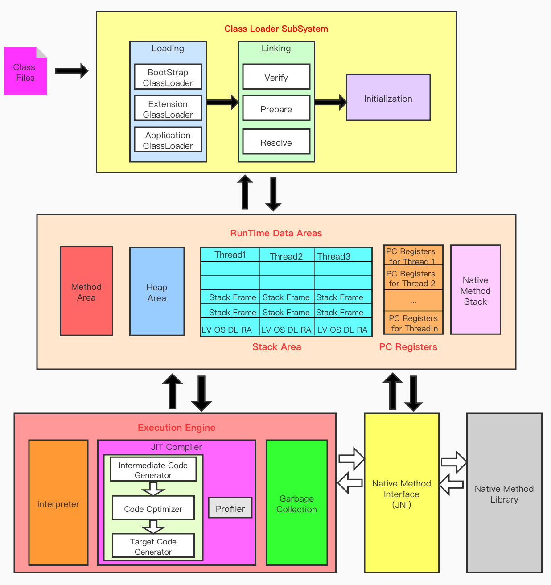
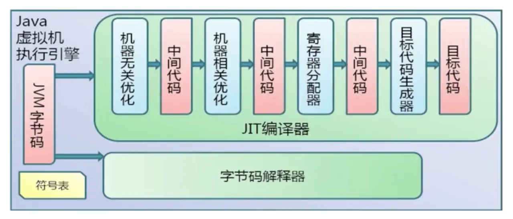

# JVM 执行过程

执行引擎是 Java 虚拟机（JVM）的核心组成部分之一。虚拟机和物理机概念上的区别，主要体现在执行引擎上：

- 物理机的执行引擎直接建立在处理器、缓存、指令集和操作系统之上。
- 虚拟机的执行引擎由软件实现，可以定制指令集和执行引擎的结构体系。

《Java 虚拟机规范》定义了字节码执行引擎的概念模型，所有 JVM 实现都要遵守，对外提供统一的执行方式。

## 执行引擎的职责

所有 JVM 的执行引擎输入、输出一致：输入字节码二进制流，处理过程是字节码解析执行的等效过程，输出执行结果。执行引擎的任务是把字节码指令解释为（或编译成）对应平台上的本地机器指令。

## 执行引擎的工作过程

1. 执行引擎执行的字节码指令由程序计数器（Program Counter，线程私有）指定。
2. 每执行完一条指令，程序计数器更新为下一条指令的地址。
3. 方法执行过程中，执行引擎通过局部变量表中的对象引用找到 Java 堆中的对象实例，再通过对象头中的类型指针定位到目标对象的类型信息。

JVM 执行引擎执行 class 字节码的流程：

## 解释执行与编译执行

现代 JVM 在执行 Java 代码时把解释执行和编译执行结合起来，HotSpot 默认采用混合模式（Mixed Mode）。

- 解释执行：将字节码逐条解释、"翻译"为对应平台的本地机器指令执行。启动快，但同一段代码重复执行时每次都要重新解释。
- 即时编译（JIT，Just-In-Time Compiler）：运行期间把热点代码（方法或循环）编译成本地机器码并缓存，后续执行直接运行机器码，执行效率显著提升。HotSpot 采用分层编译，用 C1、C2 两级编译器在编译速度和生成代码质量之间折中。
- 提前编译（AOT，Ahead-Of-Time Compiler）：在运行前把 Java 类文件编译为机器码。JDK 9 曾引入实验性的 AOT 编译工具 jaotc（JEP 295），编译产物存放在动态共享库中；因使用率过低，JDK 17 已将其移除（JEP 410）。目前 AOT 主要由 GraalVM Native Image 等方案实现，换来更快的启动速度和更低的内存占用，代价是机器码与平台绑定，失去"一次编译，到处运行"的跨平台特性。
