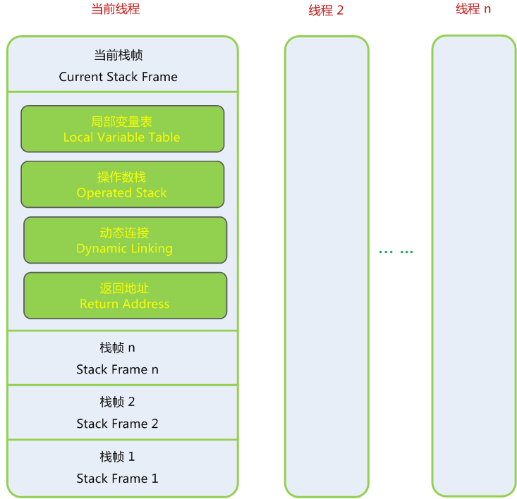

# JVM 的栈帧结构

JVM 的运行时数据区划分为程序计数器、虚拟机栈、本地方法栈、堆和方法区。栈帧（Stack Frame）是虚拟机栈的栈元素，是支持 JVM 进行方法调用和方法执行的数据结构，存储了方法的局部变量表、操作数栈、动态连接和方法返回地址等信息。

每一个方法从调用到执行完成，对应一个栈帧在虚拟机栈中从入栈到出栈的过程。方法编译为 Class 文件时，栈帧需要多大的局部变量表、多深的操作数栈就已经确定，并写入方法 Code 属性的 `max_locals` 和 `max_stack` 数据项。因此栈帧占用的内存大小只取决于具体的 JVM 实现，不受程序运行期变量数据的影响。

## 栈帧整体结构

活动线程中，虚拟机栈顶的栈帧称为当前栈帧（Current Stack Frame），与之关联的方法称为当前方法（Current Method）。字节码解释执行时，所有指令都只针对当前栈帧进行操作。

## 局部变量表（Local Variable Table）

局部变量表是一组变量值存储空间，存放方法参数和方法内部定义的局部变量。方法需要分配的局部变量表最大容量在编译期确定，记录在 Class 文件 Code 属性的 `max_locals` 数据项中。

变量槽（Variable Slot）是局部变量表的最小单位。JVM 规范没有规定一个 Slot 的长度，只说它应能存放一个 32 位以内的数据类型；64 位的 long 和 double 则占用两个连续的 Slot，高位对齐存放。各类型占用的 Slot 数如下：

| 数据类型 | 占用 Slot 数 |
| --- | --- |
| boolean、byte、char、short、int、float、reference、returnAddress | 1 |
| long、double | 2（连续） |

其中 returnAddress 是为字节码指令 jsr、jsr_w、ret 服务的类型，指向一条字节码指令的地址。从 JDK 7（Class 文件版本 51.0）起这些指令被禁用，returnAddress 类型实际已不再使用。

JVM 通过索引定位使用局部变量表：访问 32 位类型的变量时，索引 N 即第 N 个 Slot；访问 64 位类型的变量时，索引 N 对应第 N 和 N+1 两个 Slot，不允许单独访问其中一个，违反这一规则会在类加载的校验阶段抛出异常。实例方法（非 static 方法）的第 0 号 Slot 固定存放方法所属对象实例的引用，即关键字 `this` 指向的对象。

局部变量表中的 Slot 可以复用：变量离开作用域后，其占用的 Slot 可以分配给后续变量。复用能节省栈帧空间，但也带来一个副作用——如果复用的 Slot 仍保留着对某个对象的引用，即使该变量已不在使用，垃圾回收器也不会回收这个对象。

## 操作数栈（Operand Stack）

JVM 的解释执行引擎称为“基于栈的执行引擎”，这里的栈就是操作数栈（也称操作栈），是一个后入先出栈。方法执行过程中操作数栈的最大深度在编译期确定，记录在 Class 文件 Code 属性的 `max_stack` 数据项中。

方法开始执行时操作数栈为空，执行过程中字节码指令不断向栈中写入和提取数据，完成出栈、入栈操作。方法内的算术运算、方法调用时的参数传递和返回值接收，都通过操作数栈完成。

概念模型中，两个栈帧完全独立。不过大多数 JVM 实现会做优化：让调用者栈帧与被调方法栈帧的操作数栈部分重叠，被调方法的参数可以直接放在调用者操作数栈的顶端，省去一次参数复制。

## 动态连接（Dynamic Linking）

每个栈帧都包含一个指向所属方法运行时常量池的引用，以支持方法调用过程中的动态连接。

每个 Class 文件有一份常量池，存放编译期生成的各种字面量和符号引用；类加载后，常量池内容进入方法区的运行时常量池，每个被 JVM 装载的类或接口对应一份。字节码中方法调用指令的参数就是常量池中指向方法的符号引用。符号引用转为直接引用有两种时机：

- 编译期就能确定调用版本的方法，在类加载的解析阶段（或第一次使用前）完成转换，称为静态解析。符合这一条件的包括：静态方法、私有方法、实例构造器、通过 `super` 调用的父类方法，以及被 final 修饰的实例方法。
- 运行期间才能确定调用版本的方法（典型的如多态下的 invokevirtual、invokeinterface 调用），在每次运行时转换，称为动态连接。

## 方法返回地址

方法返回时需要在栈帧中保存一些信息，用于恢复调用者（调用当前方法的方法）的执行状态。

- 方法正常退出时，调用者程序计数器的值就是返回地址，栈帧中很可能会保存这个值。
- 方法异常退出（抛出异常且未被本方法捕获）时，返回地址由异常处理器表确定，栈帧中一般不保存这部分信息。

方法返回的过程等同于当前栈帧出栈，可能执行的操作有：

- 恢复调用者的局部变量表和操作数栈。
- 把返回值（如果有）压入调用者栈帧的操作数栈。
- 调整程序计数器的值，使其指向方法调用指令之后的一条指令。

## 附加信息

JVM 规范允许实现向栈帧中增加规范未描述的信息，如调试、性能收集相关的数据，具体内容完全取决于实现。

动态连接、方法返回地址和其他附加信息经常被合称为栈帧信息。
