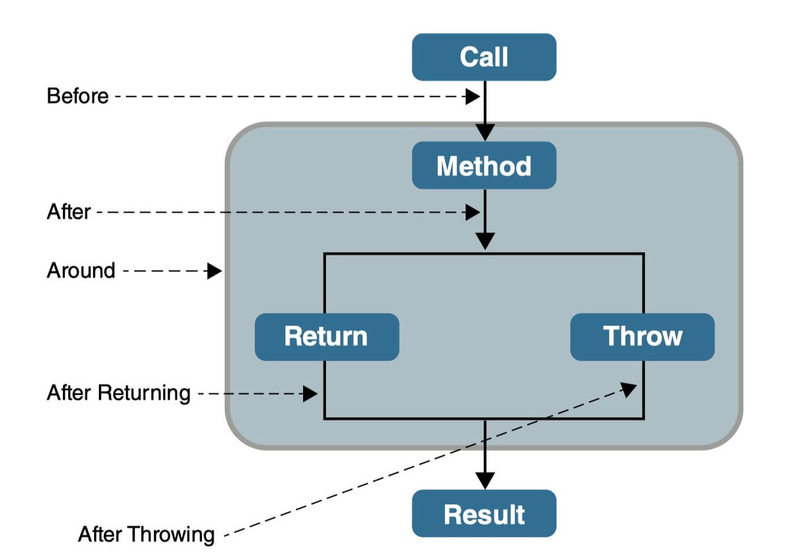

# Spring AOP 的思想与实现

AOP（Aspect Oriented Programming），即面向切面编程。OOP 把系统拆成一个个对象，但日志、事务、安全这类功能横在多个对象中间，跟谁都不属于，硬塞进某个对象都会破坏它的职责。AOP 把这类功能从业务对象中剥离出来，单独封装、统一织入，让 OOP 只关注对象的核心业务。

AOP 的切入手段是"横切"：在不修改业务对象代码的情况下，把公共行为切入到对象内部，封装成一个可重用的模块，这个模块就是切面（Aspect），也是 AOP 的基本单元。

从关注点的角度看，AOP 把应用对象分成两部分：业务处理主流程是核心关注点，与主流程关系不大的公共功能是横切关注点。

## AOP 术语

| 术语 | 英文 | 说明 |
| :--- | :--- | :--- |
| 通知 | Advice | 在目标方法之前或之后执行的增强代码，描述切面何时执行、如何执行 |
| 连接点 | Join point | 应用执行过程中可以插入切面的点，如方法调用、异常抛出。Spring AOP 中连接点仅指方法的执行 |
| 切点 | Pointcut | 一组连接点的定义，声明通知要织入到哪些方法上 |
| 切面 | Aspect | 通知与切点的结合 |
| 引入 | Introduction | 向现有类动态添加新的方法或属性 |
| 织入 | Weaving | 把公共代码添加到目标对象、生成增强对象的过程 |

通知按执行时机分为五类：

| 注解 | 名称 | 描述 |
| :--- | :--- | :--- |
| @Before | 前置通知 | 目标方法执行之前执行 |
| @AfterReturning | 返回通知 | 目标方法成功返回后执行 |
| @AfterThrowing | 异常通知 | 目标方法抛出异常退出时执行 |
| @After | 最终通知 | 目标方法退出后执行，无论正常返回还是抛异常，相当于 finally |
| @Around | 环绕通知 | 包裹目标方法，在调用前后执行，可自行决定是否继续调用目标方法 |

中文译名资料间有分歧：有的把 @AfterReturning 称作"后置通知"、@After 称作"返回后通知"，阅读其他文档时留意对应英文注解。

## Spring AOP 的实现原理

AOP 要在不修改业务代码的前提下给业务组件加入新功能，落地为两种做法：静态织入在编译阶段修改字节码（如 AspectJ），动态代理在运行阶段生成代理对象，通过包装目标对象来拦截调用。Spring AOP 走的是动态代理路线，业务源码和字节码都不改动。

### JDK 动态代理与 CGLIB

Spring AOP 按目标类的形态选择代理方式，也可以通过配置强制指定：

- 目标类实现了接口：默认用 JDK 动态代理创建接口的代理实现。
- 目标类没有接口：自动改用 CGLIB 生成目标类的子类作为代理。
- `proxyTargetClass = true`（注解 `@EnableAspectJAutoProxy(proxyTargetClass = true)` 或 XML 的 `proxy-target-class` 属性）：强制全部走 CGLIB。

Spring Boot 2.0 起，`spring.aop.proxy-target-class` 默认值改为 true，即不做任何配置时所有 Bean 默认使用 CGLIB，只有显式设为 false 且目标类有接口时才回到 JDK 动态代理。

两个常见的坑：

- CGLIB 的原理是生成子类，final 类和方法无法被代理，切面会静默不生效。
- 代理只在方法被外部对象调用时起作用，类内部通过 `this` 自调用不会经过代理，增强逻辑不会执行。

### 与 AspectJ 的关系

Spring AOP 沿用了 AspectJ 的切点表达式语法和 @AspectJ 注解风格，但它不是完整的 AspectJ：连接点只支持方法级别，也只能作用于 Spring 容器管理的 Bean。需要完整 AOP 能力（如字段拦截、构造器拦截）时要用 AspectJ 本身，Spring 通过 spring-aspects 模块做了集成。AspectJ 采用静态织入，编译期把切面织入目标类，没有运行时代理和拦截器链的开销。

### 使用 Spring AOP 的三个步骤

业务代码之外，只需要做三件事，代理由框架自动生成：

1. 确定需要切面的业务组件。
2. 定义切点，一个切点可以横切多个业务组件。
3. 编写增强代码，即通知。

## Spring AOP 的核心组件

### 解析与自动配置

使用 XML 配置时，IOC 容器解析 BeanDefinition 的过程中，会按 `spring.handlers` 中注册的命名空间处理类找到 AopNamespaceHandler，再由它把解析工作分派给具体的 BeanDefinitionParser：

- `aop:config` 标签（XML 风格）由 ConfigBeanDefinitionParser 解析。
- `aop:aspectj-autoproxy` 标签（@AspectJ 风格）由 AspectJAutoProxyBeanDefinitionParser 解析。

两者分别注册对应的代理创建器：AspectJAwareAdvisorAutoProxyCreator 和 AnnotationAwareAspectJAutoProxyCreator。

Spring Boot 场景下由自动配置类 AopAutoConfiguration 接手，它解析注解 @EnableAspectJAutoProxy（通过 AspectJAutoProxyRegistrar），完成 AnnotationAwareAspectJAutoProxyCreator 的注册，并根据 `spring.aop.proxy-target-class` 决定是否默认使用 CGLIB。

### 代理创建

代理创建的核心是 AbstractAutoProxyCreator：它实现了代理创建的完整逻辑，在 Bean 初始化后检查是否匹配某个切面，匹配则用代理包装该 Bean，方法调用进入代理后先委派给拦截器链，再到达目标方法。Spring 内部把切面中的每个通知转换为一个 Advisor 对象（通知 + 切点的组合），一个 Bean 上匹配到的所有 Advisor 按顺序构成拦截器链。

它的两个实现子类分别对应两种配置风格：

- AspectJAwareAdvisorAutoProxyCreator：处理 XML `aop:config` 声明的切面。
- AnnotationAwareAspectJAutoProxyCreator：在其基础上增加对 @AspectJ 注解切面的扫描，是注解风格实际使用的创建器。

### 代理实现

代理创建器最终委托给两种代理实现类：

- JdkDynamicAopProxy：基于 JDK 动态代理，是 InvocationHandler 的实现类。InvocationHandler 是 JDK 动态代理的核心，生成的代理对象上所有方法调用都委托到它的 `invoke()` 方法。
- CglibAopProxy：基于 CGLIB 生成目标类的子类作为代理。

除声明式配置外，Spring 还提供了编程式 API：ProxyFactory 允许开发者不依赖 XML 和注解，以编码方式直接配置切点、通知并生成代理。
