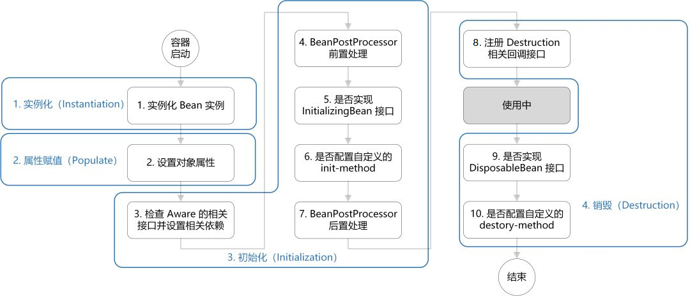

# Spring 的 Bean 管理

依赖注入（Dependency Injection）是控制反转（IoC）思想的实现方式：一个对象所需要的依赖不再由自己创建，而是在对象创建时由容器从外部传入，对象之间只依赖接口或抽象，不直接依赖具体的实现类。

Spring 的 IoC 容器接管了 Bean 的创建、装配与销毁全过程。

IoC 容器初始化时，会在容器中建立 BeanDefinition 数据映射，每一个 Bean 的配置信息对应一个 BeanDefinition。Bean 的实例化有两种触发时机：第一次向容器调用 getBean() 时触发，或者容器初始化时将 non-lazy-init 的单例 Bean 预先实例化，后者内部同样调用 getBean()。

getBean() 定义在最基础的容器接口 BeanFactory 中，由抽象实现 AbstractBeanFactory 实现，常用的 DefaultListableBeanFactory 通过继承体系（DefaultListableBeanFactory → AbstractAutowireCapableBeanFactory → AbstractBeanFactory）获得该方法。日常开发接触的 ApplicationContext 是 BeanFactory 的子接口，在其上扩展了国际化、事件发布等能力。

## Bean 的生命周期

Bean 的生命周期分为实例化、属性赋值、初始化、销毁 4 个阶段：

- 实例化（Instantiation）：容器根据 BeanDefinition 的信息创建实例，常用手段是反射调用构造器，必要时使用 CGLIB 生成代理类。
- 属性赋值（Populate）：按照配置把 Bean 的依赖注入进来，即 IoC 注入发生的位置。
- 初始化（Initialization）：Aware 接口回调让 Bean 拿到容器底层组件，随后执行 BeanPostProcessor 的前置与后置处理，最后调用初始化逻辑（InitializingBean 接口与 init-method 配置方法）。
- 销毁（Destruction）：容器关闭时触发，依次调用 DisposableBean 的 destroy() 方法与 destroy-method 声明的销毁方法。

## Bean 的扩展点

### 容器回调接口

Bean 可以实现一组 Aware 接口，在初始化阶段获得容器的底层组件：

| 接口 | 调用时机 | 传入内容 |
| --- | --- | --- |
| BeanNameAware | 属性赋值前 | Bean 的 id，传给 setBeanName() |
| BeanClassLoaderAware | 属性赋值前 | 类加载器，传给 setBeanClassLoader() |
| BeanFactoryAware | 属性赋值前 | BeanFactory 容器实例，传给 setBeanFactory() |
| ApplicationContextAware | 初始化阶段 | 应用上下文实例，传给 setApplicationContext() |

BeanPostProcessor 作用于初始化阶段的前后，postProcessBeforeInitialization() 与 postProcessAfterInitialization() 分别在被 @PostConstruct 注解的方法与 InitializingBean 逻辑前后执行，AOP 代理的生成就发生在后置处理中。

InstantiationAwareBeanPostProcessor 是 BeanPostProcessor 的子接口，作用于实例化与属性赋值阶段：

- postProcessBeforeInstantiation() 在实例化之前调用，返回一个非空对象可以直接替换目标 Bean（AOP 的切面逻辑在这里有机会提前返回代理）；

- postProcessAfterInstantiation() 返回 false 可以阻止后续属性赋值；

- postProcessProperties() 处理属性注入，@Autowired 与 @Resource 的注入逻辑就实现在这里。

### 生命周期回调

- InitializingBean：接口方法 afterPropertiesSet() 在所有属性设置完成后执行，适合做依赖完整性的校验。
- DisposableBean：接口方法 destroy() 在 Bean 销毁前执行，适合释放资源。
- init-method 与 destroy-method：在 Bean 定义中配置的初始化与销毁方法。接口回调与配置方法并存时都会执行，顺序是先接口方法、后配置方法。

## Bean 的存放位置

### BeanDefinition 的存储

容器初始化完成后，BeanDefinition 保存在 DefaultListableBeanFactory 的 beanDefinitionMap（beanName → BeanDefinition）与 beanDefinitionNames 两个集合中。配置了 parent 属性的 BeanDefinition 在使用时会与父定义合并，合并结果缓存在 mergedBeanDefinitions 中。

### Bean 实例的存储

实例化完成后，不同作用域的实例存放位置不同：singleton 实例保存在 DefaultSingletonBeanRegistry 的 singletonObjects 中；prototype 实例不缓存，直接返回给调用方；request、session 等 Web 作用域的实例保存在对应的域对象中（如 HttpServletRequest、HttpSession 的属性里）。

singleton 是默认作用域，容器为它维护了一套缓存体系，主要目的是复用实例与解决循环依赖：

| 集合 | 内容 |
| --- | --- |
| singletonObjects | 完整初始化好的单例，beanName → 实例 |
| singletonFactories | 单例工厂，beanName → ObjectFactory，用于产生早期引用 |
| earlySingletonObjects | 早期引用缓存：实例化完成但尚未完成属性赋值的对象，从 singletonFactories 升级后放入 |
| singletonsCurrentlyInCreation | 正在创建中的 Bean 名称集合，循环依赖的判定依据 |
| registeredSingletons | 已注册成功的单例名称列表 |

容器查找单例的顺序是 singletonObjects → earlySingletonObjects → singletonFactories。三级缓存配合 singletonsCurrentlyInCreation 实现了循环依赖的检测与提前暴露：A 创建过程中发现依赖 B，B 又依赖 A 时，B 通过 singletonFactories 拿到 A 的半成品引用完成注入。

另外，容器的别名机制由 SimpleAliasRegistry 的 aliasMap 维护 Bean 名与别名的映射。

## Bean 的作用域

作用域决定 Bean 实例的个数与生命周期。核心容器提供 singleton 与 prototype 两种，Web 环境的 ApplicationContext 额外提供四种，均可用 @Scope 注解指定：

| 作用域 | 实例策略 | 适用环境 |
| --- | --- | --- |
| singleton（默认） | 每个容器一个共享实例 | 核心容器 |
| prototype | 每次获取都新建实例 | 核心容器 |
| request | 每个 HTTP 请求一个实例 | Web |
| session | 每个 HTTP Session 一个实例 | Web |
| application | 每个 ServletContext 一个实例 | Web |
| websocket | 每个 WebSocket 会话一个实例 | Web |

globalSession 曾用于 Portlet 环境的全局会话，近年的 Spring 官方文档已不再列出。

## 依赖注入

为 Bean 提供初始化参数即依赖注入，常见方式有四种：

- 构造器注入：通过构造器参数注入，Bean 创建后即可完整使用。目前的普遍做法是优先使用构造器注入，因为依赖可以声明为 final 且能尽早暴露循环依赖；其代价是无法解决构造器参数自身的循环依赖，Spring 会直接抛出异常。
- setter 注入：通过 setter 方法注入，适合可选依赖与运行期需要重新配置的场景。
- 成员变量注入：用 @Autowired 直接标注字段，写法最简，但依赖不能声明为 final，且不便于单元测试与暴露循环依赖。
- 工厂方法注入：在 Bean 定义中用 factory-method 指定静态工厂方法创建实例，或用 factory-bean 引用另一个 Bean 的实例工厂方法。

XML 配置中还可以通过 autowire 属性启用自动装配，由容器按规则自动查找依赖，共五种模式：

- no：默认模式，不进行自动装配，依赖通过 ref 手动指定。
- byName：按属性名查找同名 Bean 装配。
- byType：按属性类型装配，存在多个同类型 Bean 时报错。
- constructor：与 byType 类似，应用于构造器参数。
- autodetect：先尝试 constructor、失败后退回 byType。该模式自 Spring 3.0 起弃用，仅旧版本支持，现行 XML Schema 中已不包含该取值。
