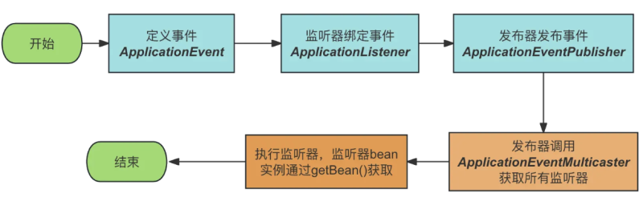

# Spring Event 模型和设计思想

## 一、核心模型与设计思想

### 1. 事件驱动模型

Spring Event 是 Spring Framework 提供的事件发布与监听机制，用于在不同组件之间传递事件、触发后续处理逻辑。

核心模型由三个角色组成：

- **事件（Event）**：描述某个业务动作或状态变化。
- **事件发布者（Publisher）**：负责发布事件，不直接调用具体的处理逻辑。
- **事件监听器（Listener）**：监听指定类型的事件，并执行对应的处理逻辑。

典型流程：



### 2. 发布者与监听者解耦

Spring Event 的核心设计思想是将事件的产生与事件的处理分离。

传统直接调用：

```
public void register(User user) {
    userService.save(user);
    emailService.sendWelcomeEmail(user);
    pointsService.initPoints(user);
    auditService.recordRegistration(user);
}
```

业务方法需要依赖多个处理组件。新增处理逻辑时，需要修改注册业务。

使用事件机制：

```
public void register(User user) {
    userService.save(user);
    eventPublisher.publishEvent(
        new UserRegisteredEvent(this, user)
    );
}
```

监听器独立处理：

```
@Component
public class UserRegisteredListener {

    @EventListener
    public void handle(UserRegisteredEvent event) {
        // 处理用户注册事件
    }
}
```

发布者只需要知道事件的含义，不需要知道有哪些监听器，也不需要知道监听器的具体实现。

这种解耦主要体现在依赖关系上，而不是自动获得异步执行能力。默认情况下，事件发布和监听器执行仍然发生在同一个线程中。

### 3. 事件的类型匹配

Spring Event 以事件类型作为监听器匹配的重要依据。

监听器声明自己感兴趣的事件类型，事件发布后，Spring 根据事件类型查找匹配的监听器。

```
@EventListener
public void handle(UserRegisteredEvent event) {
}
```

该监听器接收 `UserRegisteredEvent` 及符合类型匹配规则的子类型事件。

Spring Event 不要求事件继承 `ApplicationEvent`。从 Spring Framework 4.2 开始，普通 Java 对象可以直接作为事件发布：事件对象可以是普通 POJO，也可以是继承 `ApplicationEvent` 的类。

### 4. 同步执行与异步执行

Spring Event 默认采用同步执行模式。监听器执行期间，发布方法不会返回。同步执行时，监听器抛出的异常会传播给发布者。

通过异步执行配置，可以让监听器在其他线程中执行：

```
@Async
@EventListener
public void handle(UserRegisteredEvent event) {
    // 异步处理
}
```

同时需要启用 Spring 的异步方法支持，例如使用 `@EnableAsync`。

异步执行会改变线程上下文、异常传播和事务参与方式。事件发布成功并不代表异步监听器已经执行成功。

### 5. Spring Event 与业务事务

Spring Event 本身不提供事务管理，也不保证事件与业务数据具有原子性。

在事务方法中发布普通事件时，默认同步监听器会在发布调用期间执行，此时业务事务可能尚未提交。

```
@Transactional
public void register(User user) {
    userRepository.save(user);
    eventPublisher.publishEvent(
        new UserRegisteredEvent(this, user)
    );
}
```

如果监听器需要在业务事务提交后执行，可以使用事务事件监听器：

```
@TransactionalEventListener(
    phase = TransactionPhase.AFTER_COMMIT
)
public void handle(UserRegisteredEvent event) {
    // 事务提交后处理
}
```

`@TransactionalEventListener` 默认绑定到 `AFTER_COMMIT` 阶段。

事务事件监听器适合处理提交后的通知、缓存更新等工作，但它不等同于可靠消息队列。若要求进程崩溃后仍然能够保证事件投递，单纯依靠 Spring Event 不够。

## 二、核心架构与接口体系

### 1. 核心架构

Spring Event 的核心实现集中在事件发布、监听器管理和监听器执行三个环节。

```
ApplicationEventPublisher
          |
          v
AbstractApplicationContext
          |
          v
ApplicationEventMulticaster
          |
          v
ApplicationListener
```

`@EventListener` 还涉及注解解析和适配器机制：

```
@EventListener 方法
        |
        v
EventListenerMethodProcessor
        |
        v
ApplicationListenerMethodAdapter
        |
        v
ApplicationEventMulticaster
```

监听器的工作分为注册和分发两个独立阶段。注册发生在容器初始化期：容器识别实现 `ApplicationListener` 的 Bean，处理 `@EventListener` 方法，将对应监听器注册到事件广播器。分发发生在事件发布时：广播器从已注册的监听器中筛选匹配项，依次调用或交由配置的执行器处理。监听器注册不涉及事件持久化，分发依赖已经建立的监听器注册体系。

### 2. ApplicationEventPublisher

`ApplicationEventPublisher` 是事件发布的核心抽象。

```
public interface ApplicationEventPublisher {

    default void publishEvent(ApplicationEvent event) {
        publishEvent((Object) event);
    }

    void publishEvent(Object event);
}
```

其职责是提供统一的事件发布入口，屏蔽事件分发的具体实现。

业务代码通常通过依赖注入获得该接口：

```
@Autowired
private ApplicationEventPublisher eventPublisher;
```

调用者只负责提交事件对象，不负责查找监听器、判断监听器类型或调用监听器方法。

`ApplicationContext` 继承了 `ApplicationEventPublisher`，因此 Spring 容器本身也可以发布事件。

### 3. ApplicationEvent 与 PayloadApplicationEvent

`ApplicationEvent` 是 Spring 传统事件模型的基类，继承自 Java 的 `EventObject`。

```
public class UserRegisteredEvent extends ApplicationEvent {

    private final User user;

    public UserRegisteredEvent(Object source, User user) {
        super(source);
        this.user = user;
    }

    public User getUser() {
        return user;
    }
}
```

其中，`source` 表示事件来源，业务数据由事件自身的属性承载。

对于普通 POJO 事件，Spring 会使用 `PayloadApplicationEvent` 包装事件对象，使其进入统一的事件分发体系。

因此，事件发布入口接收 `Object`，而底层分发仍然可以使用统一的 Spring 事件模型。

### 4. ApplicationEventMulticaster

`ApplicationEventMulticaster` 是事件分发的核心接口，负责管理监听器并向匹配的监听器广播事件。

核心职责包括：

- 添加和移除监听器。
- 根据事件类型和监听器条件筛选目标监听器。
- 将事件分发给匹配的监听器。
- 支持通过执行器控制监听器的调用方式。

常见实现是 `SimpleApplicationEventMulticaster`。

默认配置下，它在当前线程中依次调用匹配的监听器；配置任务执行器后，可以改变监听器的执行线程。

`ApplicationEventMulticaster` 不负责业务事件的持久化，也不负责保证事件至少投递一次或恰好投递一次。

### 5. 监听器的两种声明方式

**编程式监听：实现 ApplicationListener**

`ApplicationListener` 是编程式事件监听器接口。

```
public interface ApplicationListener<E extends ApplicationEvent>
        extends EventListener {

    void onApplicationEvent(E event);
}
```

实现示例：

```
@Component
public class UserRegisteredListener
        implements ApplicationListener<UserRegisteredEvent> {

    @Override
    public void onApplicationEvent(UserRegisteredEvent event) {
        // 处理事件
    }
}
```

Spring 可以从监听器的泛型信息中识别其关注的事件类型，并在分发时进行匹配。

对于需要在容器启动阶段接收事件的监听器，还存在 `ApplicationContext` 生命周期相关的注册时机问题。容器早期发布的事件不一定能被尚未注册的监听器接收。

**声明式监听：@EventListener**

`@EventListener` 是基于方法的声明式监听方式。

```
@Component
public class UserEventHandler {

    @EventListener
    public void handle(UserRegisteredEvent event) {
        // 处理事件
    }
}
```

它不是独立的事件分发引擎，而是建立在 Spring 现有事件发布和广播体系之上的方法适配机制。

主要参与组件：

| 组件                               | 职责                                 |
| ---------------------------------- | ------------------------------------ |
| `EventListenerMethodProcessor`     | 扫描 Bean 中的 `@EventListener` 方法 |
| `EventListenerFactory`             | 创建注解监听方法对应的监听器适配对象 |
| `ApplicationListenerMethodAdapter` | 将事件分发转换为目标方法调用         |
| `ApplicationEventMulticaster`      | 统一广播事件并调用监听器             |

`EventListenerMethodProcessor` 实现了容器 Bean 后处理相关接口，在 Bean 创建完成后识别监听方法，并将对应的适配器注册为事件监听器。

`ApplicationListenerMethodAdapter` 负责解析事件参数、判断方法条件，并通过 Spring 的方法调用基础设施执行目标方法。

## 三、底层调用链

### 1. 事件发布入口：AbstractApplicationContext.publishEvent()

以 `ApplicationContext` 发布自定义事件为例，核心调用路径如下：

```
eventPublisher.publishEvent(event)
             |
             v
AbstractApplicationContext.publishEvent(...)
             |
             | 判断事件类型
             | 必要时包装为 PayloadApplicationEvent
             v
ApplicationEventMulticaster.multicastEvent(...)
             |
             v
AbstractApplicationEventMulticaster
获取匹配的监听器
             |
             v
SimpleApplicationEventMulticaster
遍历匹配的监听器
             |
             v
ApplicationListener.onApplicationEvent(...)
             |
             v
执行监听器逻辑
```

`publishEvent()` 的实际实现位于 `AbstractApplicationContext`，它是发布流程的关键入口，核心处理可以概括为：

1. 检查事件对象。
2. 判断事件是否为 `ApplicationEvent`。
3. 对普通对象事件进行必要的包装，由 `PayloadApplicationEvent` 完成。
4. 确定事件类型信息，通过 `ResolvableType` 表达，供后续监听器匹配使用。
5. 将事件交给容器中的事件广播器。
6. 在适用的情况下，将事件传播给父容器。

父子容器之间的事件传播是容器层面的行为，不是监听器自动跨容器注册。子容器发布的事件可以向父容器传播，但父容器发布的事件不会因此自动向子容器传播。

这几个组件的职责相互独立：事件发布不直接负责监听器查找，监听器查找不直接负责业务处理，广播器也不负责定义业务事件的含义。

### 2. 监听器筛选：AbstractApplicationEventMulticaster

广播器不会在每次发布事件时重新扫描所有 Bean 中的 `@EventListener` 方法。

监听器在容器初始化阶段已经完成注册。发布事件时，广播器根据事件类型等条件筛选候选监听器。

主要匹配因素包括：

- 事件类型：监听器声明的事件类型是否能够接收当前事件。
- 泛型信息：对于支持解析的泛型事件，进一步匹配泛型参数。
- 监听器条件：使用 `@EventListener(condition = "...")` 时，适配器还会计算对应的 SpEL 条件。

例如：

```
@EventListener(
    condition = "#event.user.status == 'ACTIVE'"
)
public void handle(UserRegisteredEvent event) {
    // 仅处理符合条件的事件
}
```

这里的条件判断由注解监听器适配机制处理，而不是由业务发布者处理。

### 3. 事件广播：SimpleApplicationEventMulticaster

`SimpleApplicationEventMulticaster` 是默认事件广播器的典型实现。

其核心逻辑可以简化为：

```
public void multicastEvent(
        ApplicationEvent event,
        ResolvableType eventType) {

    ResolvableType type = eventType != null
            ? eventType
            : ResolvableType.forInstance(event);

    for (ApplicationListener<?> listener :
            getApplicationListeners(event, type)) {

        Executor executor = getTaskExecutor();

        if (executor != null
                && listener.supportsAsyncExecution()) {
            executor.execute(() ->
                invokeListener(listener, event)
            );
        } else {
            invokeListener(listener, event);
        }
    }
}
```

这是用于说明核心机制的简化代码，不是 Spring 源码的逐行复刻。

关键在于两个步骤。

第一步：获取匹配的监听器。

```
getApplicationListeners(event, type)
```

该方法由 `AbstractApplicationEventMulticaster` 提供相关实现，返回适用于当前事件的监听器集合。

第二步：执行监听器。

```
invokeListener(listener, event)
```

在默认同步配置下，监听器在当前发布线程中执行。

配置执行器后，广播器可以将支持异步执行的监听器提交给执行器。Spring Framework 6.1 及之后的版本还引入了 `ApplicationListener.supportsAsyncExecution()`，因此不能简单认为配置执行器后所有监听器都会异步执行。

### 4. 方法适配：ApplicationListenerMethodAdapter

使用 `@EventListener` 时，最终注册到广播器中的不是原始 Java 方法，而是实现了 `ApplicationListener` 的适配器对象。

调用链如下：

```
SimpleApplicationEventMulticaster
             |
             v
ApplicationListenerMethodAdapter
             |
             v
判断事件类型与监听条件
             |
             v
解析事件参数
             |
             v
调用目标 Bean 的监听方法
```

例如：

```
@EventListener
public void handle(UserRegisteredEvent event) {
    System.out.println(event.getUser());
}
```

`ApplicationListenerMethodAdapter` 将事件对象转换为方法参数，再通过 Spring 的方法调用基础设施调用目标方法。

如果监听方法配置了 `condition`，适配器会先判断条件是否成立；如果方法返回了非空事件对象，且返回值符合事件发布规则，该返回值还可以作为新事件继续发布。

因此，`@EventListener` 并没有替代 `ApplicationListener` 和 `ApplicationEventMulticaster`。它只是把方法级监听声明适配到了既有的事件分发体系中。

### 5. 事务事件：@TransactionalEventListener 的执行链

`@TransactionalEventListener` 在普通事件监听的基础上增加了事务阶段控制。

```
publishEvent(event)
        |
        v
匹配事务事件监听器
        |
        v
判断当前事务是否存在
        |
        v
注册事务同步回调
        |
        v
等待指定事务阶段
        |
        v
执行监听器方法
```

默认的 `AFTER_COMMIT` 阶段会在事务成功提交后触发监听器。其他阶段还包括 `BEFORE_COMMIT`、`AFTER_ROLLBACK` 和 `AFTER_COMPLETION`。

这里的关键差异是：事务事件监听器不是简单地在 `publishEvent()` 调用期间立即执行业务方法，而是根据事务状态安排后续执行。

如果没有活动事务，默认情况下事务事件监听器不会执行。设置 `fallbackExecution = true` 后，才允许在没有事务的情况下回退到直接执行。

事务事件监听器仍然使用 Spring 的事件发布与监听基础设施，事务阶段控制则由事务同步机制完成。