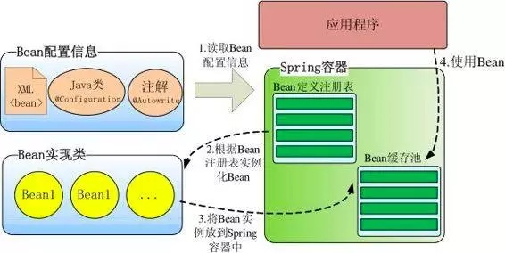
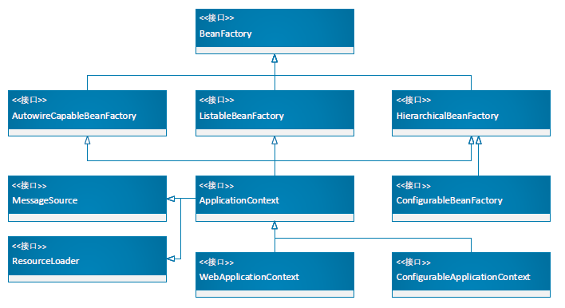

# Spring 的 IoC 容器

IoC（Inversion of Control）即“控制反转”：把对象的创建和依赖关系交给容器管理，而不是在对象内部自己控制。它是一种思想，用于指导松耦合设计；具体落地是在程序运行期，动态地向一个对象提供它所需要的其他对象，这一机制通过 DI 实现。

DI（Dependency Injection）即“依赖注入”：组件之间的依赖关系由容器在运行期决定，Spring 通过反射把容器内托管的对象注入到需要它的对象中。

## 容器的实现

IoC 容器是工厂模式的典型应用，它本质是一个 Bean 工厂，管理所有 Bean 及它们之间的依赖关系，并提供 Bean 实例缓存、生命周期管理、Bean 实例代理、事件发布、资源装载等高级服务。

Spring 启动时读取应用程序提供的 Bean 配置信息，在容器中生成一份相应的 Bean 配置注册表，再根据这张注册表实例化 Bean、装配好 Bean 之间的依赖关系。上层应用一般无需关注这一过程，由容器自动装配完成，也可以直接调用 `getBean()` 获取 Bean。

为 Spring 容器提供配置元数据的方式主要有三种：XML 配置文件、注解配置、Java 配置（`@Configuration`）。

对已经实例化的单例 Bean，Spring 将其缓存在一个以 HashMap 为数据结构的单例缓存器中。

## 容器的体系

BeanFactory 是 IoC 容器的基础接口，提供最基本的 DI 支持；ApplicationContext 继承自 BeanFactory，是较高级的容器，也被称为 Spring 上下文；此外还有面向 Web 应用的容器。

- **BeanFactory**：Spring 框架的基础设施，主要面向 Spring 本身使用。它会缓存单例（singleton）Bean，以 beanName 为 key 保存在 `DefaultSingletonBeanRegistry` 的 `singletonObjects`（一个 ConcurrentHashMap）中。BeanFactory 体系的直接实现类是 `DefaultListableBeanFactory`。
- **ApplicationContext**：面向应用程序开发者，是 BeanFactory 的子接口。常见的实现类有 `ClassPathXmlApplicationContext`（默认从类路径加载配置文件）、`FileSystemXmlApplicationContext`（默认从文件系统加载配置文件）、`AnnotationConfigApplicationContext`（基于 Java 配置类启动）。
- **WebApplicationContext**：ApplicationContext 子接口中专门为 Web 应用准备的容器，允许从相对于 Web 根目录的路径装载配置文件完成初始化。初始化后，整个 Web 应用上下文对象会作为属性放置到 `ServletContext` 中，key 为常量 `ROOT_WEB_APPLICATION_CONTEXT_ATTRIBUTE`。常见的实现类有 `XmlWebApplicationContext` 和 `AnnotationConfigWebApplicationContext`。

BeanFactory 与 ApplicationContext 的一个关键区别在实例化时机：BeanFactory 采用懒加载，只有调用 `getBean()` 时才创建 Bean；ApplicationContext 在容器启动时就会实例化所有单例 Bean，配置错误能在启动阶段尽早暴露。日常开发基本都使用 ApplicationContext。

## 容器的组件构成

IoC 容器内部有若干重要组件，彼此协作完成 Bean 的加载与注册：

- **Resource**：资源组件，Spring 对资源的统一抽象，XML、properties 等不同格式的资源文件由 ResourceLoader 加载后得到相应的 Resource 对象，有 `ClassPathResource`、`FileSystemResource`、`UrlResource` 等具体类型。
- **ResourceLoader**：资源加载组件，负责加载 XML、properties 等各类资源并解析生成 Resource 对象。`DefaultResourceLoader` 是其默认实现；`ResourcePatternResolver` 在其上提供各种资源匹配模式（如 classpath\* 通配）。
- **BeanDefinition**：Bean 描述组件，Spring 内部表示 Bean 信息的基本数据结构，包含属性、构造方法参数、依赖的 Bean 名称、是否单例、是否延迟加载等元数据，并提供了一系列读写这些元数据的方法。它是实例化 Bean 的原材料。
- **BeanDefinitionReader**：Bean 构造组件，利用 ResourceLoader 读取 Resource，把资源中的数据转换成对应的 BeanDefinition 对象，再利用 BeanDefinitionRegistry 完成注册。
- **BeanRegistry**：Bean 注册组件。`BeanDefinitionRegistry` 负责把 BeanDefinition 注册到容器（`beanDefinitionMap`）中；`SingletonBeanRegistry` 负责注册单例 Bean 的实例，二者职责不同。

## 容器的初始化过程

不论使用 BeanFactory 系列还是 ApplicationContext 系列创建容器，最终基本都会用到 `DefaultListableBeanFactory`，它也是实际默认的 IoC 容器。

ApplicationContext 的各个子类创建 IoC 容器时，最终都会调用 `AbstractApplicationContext` 的核心方法 `refresh()`，完整的初始化过程在其中完成，核心有三个步骤：

- **Resource 定位**：定位 Bean 的定义文件。ResourceLoader 接口提供不同的 Resource 加载策略，把各类资源转换为 Resource 对象。
- **BeanDefinition 载入**：把定位好的资源载入为 BeanDefinition，将 Bean 的信息实例化为 BeanDefinition 对象。
- **BeanDefinition 注册**：调用 BeanDefinitionRegistry，把 BeanDefinition 对象注册到 IoC 容器（`beanDefinitionMap`）中。

经过这三步，IoC 容器就以 BeanDefinition 对象的形式维护了整个 Bean 的配置信息，放置在 `beanDefinitionMap` 中，供后续依赖注入（`getBean()`）时检索与使用。
