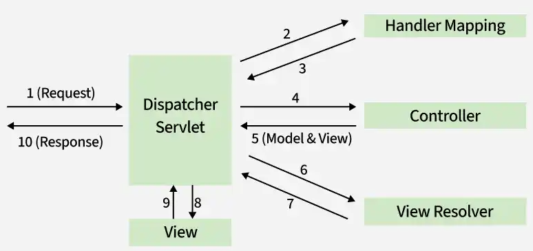
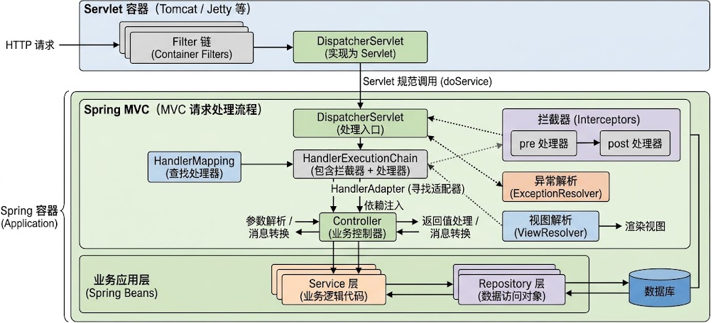
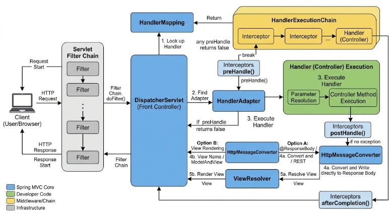

# Spring MVC 核心思想与工作原理

## 一、核心思想与设计理念

### 1.1 前端控制器模式

Spring MVC 是基于 Servlet API 构建的 Web MVC 框架，核心采用 **Front Controller（前端控制器）模式**。所有请求由统一的入口进行调度，具体请求处理、异常处理、视图解析等工作由不同的组件负责。

核心入口是 `DispatcherServlet`。

原生 Servlet 需要自行处理请求参数、业务调用、响应输出等逻辑。Spring MVC 将这些抽象为一套标准处理流程，由框架统一管理，开发者只需声明请求映射，并实现具体的 Controller 方法。



`DispatcherServlet` 不直接承担所有处理职责。它定义一套公共的请求处理流程，把各环节委托给可配置的组件执行，自己只做中央调度。

官方文档：[Spring MVC DispatcherServlet](https://docs.spring.io/spring-framework/reference/web/webmvc/mvc-servlet.html)。

### 1.2 控制流程与业务逻辑分离

Spring MVC 将 Web 请求处理过程划分为不同职责：

- **请求分发**：根据请求特征寻找合适的处理器。
- **请求处理**：由 Controller 方法执行应用层逻辑。
- **参数解析**：将 HTTP 请求中的参数转换为 Java 方法参数。
- **结果处理**：根据返回值类型决定渲染视图，或者直接写入 HTTP 响应体。
- **异常处理**：将处理过程中出现的异常转换为适当的 HTTP 响应。

这些职责不要求每个 Controller 重复实现，而是由框架组件完成。

例如：

```
@RestController
@RequestMapping("/users")
public class UserController {

    @GetMapping("/{id}")
    public User getUser(@PathVariable Long id) {
        return userService.getById(id);
    }
}
```

Controller 只声明 URL 与 Java 方法之间的映射关系，以及业务调用逻辑。路径匹配、路径变量解析、方法参数转换、方法调用和 JSON 序列化等工作由 Spring MVC 的基础设施完成。

### 1.3 基于策略接口的组件协作

Spring MVC 的设计重点是将处理链的关键环节抽象为策略接口。更换某类处理器的实现时，不必重新设计整个请求调度流程。

核心策略接口包括：

- `HandlerMapping`：确定请求对应的处理器。
- `HandlerAdapter`：负责调用具体处理器。
- `HandlerExceptionResolver`：负责解析请求处理过程中的异常。
- `ViewResolver`：负责将逻辑视图名解析为具体视图。
- `HttpMessageConverter`：负责 HTTP 请求体和响应体的读取、写入与类型转换。

这种设计带来三个特点：

1. **统一流程**：请求入口和公共处理步骤由框架控制。
2. **职责隔离**：不同组件只负责自己的处理环节。
3. **可扩展性**：可以替换或扩展请求映射、参数解析、消息转换、异常处理等实现。

### 1.4 声明式编程与约定式开发

Spring MVC 使用注解描述请求处理规则，将映射信息与 Java 方法关联起来。

常见注解包括：

```
@RequestMapping
@GetMapping
@PostMapping
@PathVariable
@RequestParam
@RequestBody
@ResponseBody
@RestController
```

注解是使用入口，真正执行请求匹配和方法调用的是框架内部的组件。

## 二、核心组件

### 2.1 整体架构

Spring MVC 的运行建立在 Servlet 容器和 Spring 容器之上。



- Servlet 容器负责接收 HTTP 请求，并按照 Servlet 规范调用 `DispatcherServlet`。
- Spring 容器负责管理相关组件及其依赖关系。
- Spring MVC 负责组织请求处理流程，但不替代 Servlet 容器。

### 2.2 DispatcherServlet：中央调度器

`DispatcherServlet` 是 Spring MVC 的核心入口，继承链为 `DispatcherServlet → FrameworkServlet → HttpServletBean → HttpServlet`，最终基于 Servlet API。

它主要负责：

- 初始化和获取 Web 应用上下文。
- 查找能够处理当前请求的处理器。
- 找到能够执行该处理器的适配器。
- 协调拦截器执行。
- 调用处理器并处理执行结果。
- 协调异常解析和视图渲染。

核心分发逻辑位于 `doDispatch()` 方法中。`DispatcherServlet` 的职责是组织处理流程。

`DispatcherServlet` 通过查找 `WebApplicationContext` 中的特定类型组件来获取处理策略；找不到相应组件时，框架按默认策略处理。

### 2.3 HandlerMapping 与 HandlerExecutionChain：请求映射与执行链

`HandlerMapping` 负责根据当前 HTTP 请求确定对应的处理器。它会考虑以下匹配条件：

- 请求路径。
- HTTP 方法。
- 请求参数条件。
- 请求头条件。
- `Content-Type` 与 `Accept`。
- 路径变量及其他映射条件。

基于注解的开发方式中，常用实现是 `RequestMappingHandlerMapping`。它在初始化阶段识别 Controller 中的映射声明，建立请求条件与处理器方法之间的对应关系；请求到来时按条件匹配，得到能够处理请求的对象及其执行链。对于注解式 Controller，处理器是一个 `HandlerMethod`，包含目标 Bean 和对应的 Java 方法。

`HandlerMapping` 只负责确定处理器，不负责执行 Controller 方法。

匹配的结果不是处理器本身，而是一个 `HandlerExecutionChain`，它将处理器与一组适用的 `HandlerInterceptor` 组合在一起：

```
HandlerExecutionChain
    ├── Handler
    └── Interceptors
         ├── Interceptor A
         ├── Interceptor B
         └── Interceptor C
```

执行适配器调用之前，框架按顺序执行拦截器的前置处理；处理完成后执行后置处理和完成回调。

### 2.4 HandlerAdapter：处理器适配器

`HandlerAdapter` 负责执行 `HandlerMapping` 返回的处理器，解决处理器类型与统一调度流程之间的适配问题。`DispatcherServlet` 不需要了解每一种处理器的调用方式，只需找到支持该处理器的适配器，通过统一接口完成调用。

对于注解式 Controller，主要使用 `RequestMappingHandlerAdapter`。它内部涉及多个机制：

- `HandlerMethodArgumentResolver`：解析 Controller 方法参数。
- `WebDataBinder`：负责属性绑定、类型转换以及相关绑定处理。
- `HandlerMethodReturnValueHandler`：处理 Controller 方法的返回值。
- `HttpMessageConverter`：在特定参数解析器或返回值处理器中读取请求体、写入响应体。

这些组件使 Controller 方法能够使用不同类型的参数和返回值，而不必直接操作底层 Servlet API。

### 2.5 Controller：请求处理器

Controller 是业务请求在 Web 层的处理入口。Spring MVC 不要求注解式 Controller 继承特定基类，也不要求实现专用的处理器接口；框架根据映射信息定位目标方法，再由适配器负责调用。

Controller 的处理职责包括：

- 接收和校验请求参数。
- 调用应用服务。
- 将业务结果组织为响应数据。
- 声明视图名或 HTTP 响应状态。

不应将数据库访问、复杂业务规则和跨领域流程堆积在 Controller 中。Spring MVC 负责 Web 层的请求处理，业务职责由应用自身组织。

### 2.6 结果处理：HttpMessageConverter 与 ViewResolver

Controller 返回值有两条互斥的处理路径：**写入 HTTP 响应体**或**渲染视图**。这两套机制互不相同，前者由 `HttpMessageConverter` 完成，后者由 `ViewResolver` 与 `View` 完成。

**响应体路径。** `HttpMessageConverter` 负责 Java 对象与 HTTP 消息体之间的转换，是 REST API 的基础设施：

```
请求方向：  HTTP JSON → HttpMessageConverter → Java 对象 → Controller 方法
响应方向：  Controller 返回对象 → HttpMessageConverter → HTTP JSON
```

`@RequestBody` 表示请求体需要被读取并绑定为方法参数，由参数解析器协调消息转换器完成读取。在 `@RestController` 下，返回值经过响应体处理机制，由合适的消息转换器序列化为 JSON。

**视图路径。** 在 `@Controller` 中，可以返回逻辑视图名，并通过 `Model` 传递页面数据：

```
@Controller
public class PageController {

    @GetMapping("/users")
    public String users(Model model) {
        model.addAttribute("users", userService.list());
        return "users";
    }
}
```

其中：

- `Model` 保存提供给视图的数据。
- 返回值 `"users"` 是逻辑视图名。
- `ViewResolver` 根据配置将逻辑视图名解析为具体的 `View`。
- `View` 负责将模型数据渲染为最终响应。

`ModelAndView` 可以同时承载模型数据和视图信息。

路径的选择取决于返回值处理方式：使用 `@ResponseBody` 或 `@RestController` 时，返回值进入响应体处理机制，不再进行视图解析和渲染；否则按视图路径处理。

### 2.7 HandlerExceptionResolver：异常解析

`HandlerExceptionResolver` 负责处理请求执行过程中交由 Spring MVC 处理的异常。它的工作不是简单捕获所有异常，而是判断异常能否由某个解析器处理，以及如何生成响应或视图。

典型实现包括：

- `ExceptionHandlerExceptionResolver`：处理 `@ExceptionHandler` 标注的异常处理方法。
- `ResponseStatusExceptionResolver`：处理 `@ResponseStatus` 声明的响应状态。
- `DefaultHandlerExceptionResolver`：处理 Spring MVC 定义的标准异常。

通常，项目中通过 `@ControllerAdvice` 与 `@ExceptionHandler` 统一处理 Controller 层异常，最终仍由异常解析机制参与调度。

## 三、工作流程

### 3.1 初始化阶段

Spring MVC 的基础设施组件需要先注册和初始化，请求才能正常处理。以注解式 Controller 为例，主要过程包括：

1. 创建和初始化 `DispatcherServlet`。
2. 获取其关联的 `WebApplicationContext`。
3. 初始化或发现请求映射、处理器适配器、异常解析器、视图解析器等组件。
4. 扫描并识别 Controller 中的请求映射声明。
5. 将请求映射信息注册到对应的映射组件中。

注解声明与实际请求处理不是同一过程。框架在初始化阶段建立映射信息，在请求到来时进行匹配和调用。

### 3.2 请求处理主流程

一次典型请求的流程如下：



### 流程核心步骤概述：

1. **客户端发起请求**：客户端发送 HTTP 请求至服务器。
2. **Servlet 容器层**：经过 Servlet 容器的 `Filter` 链处理后，到达前端控制器 `DispatcherServlet / doDispatch()`。
3. **初始化与查找**：
   - 检查并解析 `Multipart` 文件上传请求。
   - 通过 `HandlerMapping` 查找处理器，获得 `HandlerExecutionChain`（处理器执行链，包含拦截器）。
   - 选择合适的 `HandlerAdapter`（处理器适配器）。
4. **拦截器前置处理**：执行 `HandlerInterceptor.preHandle()` 方法。
5. **参数与执行**：
   - 解析方法参数、进行类型转换与数据绑定。
   - 调用 `Controller` 方法并处理返回值。
6. **拦截器后置处理**：执行 `HandlerInterceptor.postHandle()` 方法。
7. **响应处理与视图渲染（分支）**：
   - **JSON/文本响应**：通过 `HttpMessageConverter` 进行 HTTP 响应体处理。
   - **页面响应**：通过 `ViewResolver / View` 进行视图解析与渲染。
8. **完成与返回**：执行 `HandlerInterceptor.afterCompletion()` 之后，最终将 **HTTP 响应** 返回给客户端。

### 3.3 参数解析与返回值处理

Spring MVC 允许 Controller 方法使用多种参数类型，不需要手动从 `HttpServletRequest` 中逐项读取数据：

```
@GetMapping("/users/{id}")
public User get(
        @PathVariable Long id,
        @RequestParam(defaultValue = "1") Integer page,
        @RequestHeader("X-Request-Id") String requestId) {

    return userService.getById(id);
}
```

执行过程中，`RequestMappingHandlerAdapter` 通过方法调用基础设施解析参数，不同参数由相应的 `HandlerMethodArgumentResolver` 处理：

- `@PathVariable`：解析路径变量。
- `@RequestParam`：解析请求参数。
- `@RequestHeader`：解析请求头。
- `@RequestBody`：利用消息转换机制读取请求体。
- `@ModelAttribute`：通过数据绑定机制构建或填充对象。
- `HttpServletRequest` 等 Servlet 类型：提供对应的请求上下文对象。

参数解析不仅涉及取值，还可能涉及类型转换、格式化、数据绑定和校验。例如，请求中的字符串 `"123"` 可以在类型转换机制下转换为 `Long`；转换失败时，异常交由异常处理流程处理。

返回值一侧，含义取决于方法声明和注解：`@RestController` 组合了 `@Controller` 与 `@ResponseBody` 的语义，方法返回值按响应体处理；普通 `@Controller` 返回字符串则被解释为逻辑视图名。两类返回值的结果路径，由 `HandlerMethodReturnValueHandler` 体系分派处理。

### 3.4 异常处理路径与流程分支

Controller 方法执行、参数解析、数据绑定或消息转换等阶段都可能产生异常，Spring MVC 将适用的异常交给异常解析机制处理：

```
请求执行过程中发生异常
          |
          v
DispatcherServlet 异常处理流程
          |
          v
HandlerExceptionResolver
          |
          +-- @ExceptionHandler
          |
          +-- @ResponseStatus 等状态映射
          |
          +-- 框架默认异常解析
          |
          v
HTTP 错误响应 / 错误视图
```

`@ExceptionHandler` 定义局部异常处理方法；`@ControllerAdvice` 将异常处理逻辑应用于多个 Controller。异常没有被任何解析机制处理时，继续向上层传播，最终可能由 Servlet 容器处理。

异常流程意味着 Controller 方法可能没有执行。例如路径参数不能转换为目标类型时，请求在参数解析阶段就失败了，异常处理机制仍会将这个错误转换为统一响应。同样，拦截器前置处理返回 `false` 终止请求时，后续的 Controller 调用也不会发生。

## 四、高频应用特性

**拦截器链（Interceptor Chain）**：

- 相比 Servlet Filter，Spring MVC 拦截器能够直接获取目标方法（HandlerMethod）的上下文信息。
- 适用于细粒度的权限检查、接口耗时统计、多语言/多租户上下文切换。

**统一异常处理机制（Global Exception Handling）**：

- 基于 `@ControllerAdvice`（或 `@RestControllerAdvice`）和 `@ExceptionHandler`。
- 拦截全局抛出的特定异常（如 `BusinessException`、`MethodArgumentNotValidException`），将其转换为统一的 API 响应结构，避免异常堆栈直接暴露给前端。

**内容协商机制（Content Negotiation）**：

- 依靠 `ContentNegotiatingViewResolver` 或 `RequestMappingHandlerAdapter`。
- 根据客户端请求头中的 `Accept` 字段或 URL 后缀（如 `.json`、`.xml`），自动选择对应的 `HttpMessageConverter` 或 `View` 进行输出。

**异步请求处理（Async Request Processing）**：

- 支持 `Callable`、`DeferredResult`、`CompletableFuture` 返回值。
- 允许 Controller 释放 Servlet 容器线程，由专门的异步线程池处理耗时业务，提升高并发场景下的吞吐量。