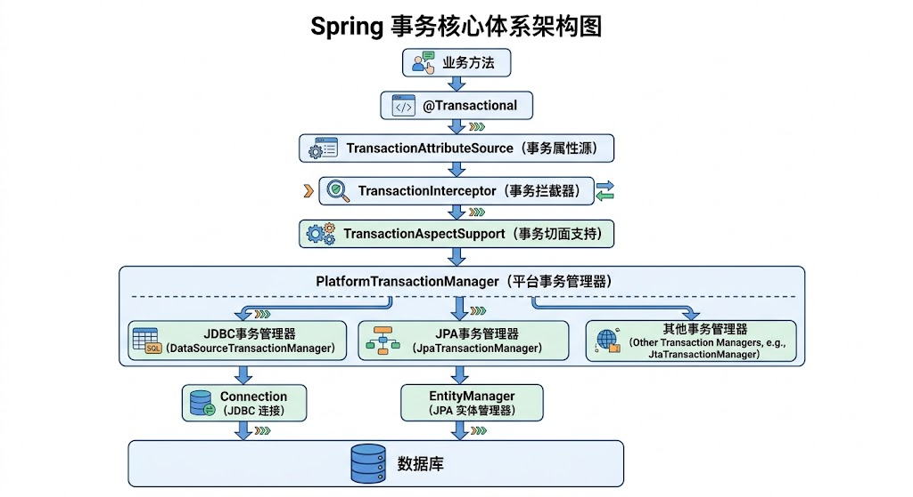

# Spring事务处理核心原理

## Spring事务的特点与设计

### 1. 事务的基本特性

数据库事务遵循 ACID 四大特性：

- **原子性（Atomicity）**：事务中的操作要么全部成功，要么全部失败回滚。
- **一致性（Consistency）**：事务执行前后，数据库都满足既定的约束和业务规则。
- **隔离性（Isolation）**：并发事务之间相互隔离，避免不符合隔离级别要求的数据干扰。
- **持久性（Durability）**：事务提交后，数据变更能够持久保存。

ACID 是数据库事务的基本要求。Spring 不负责重新实现数据库的原子性和持久性，而是通过事务管理器、事务资源和事务控制机制，协调应用程序与底层事务资源之间的关系。

### 2. Spring事务的核心特点

**统一事务抽象。** Spring 将不同底层事务资源的操作统一到 `PlatformTransactionManager` 接口中。应用代码不需要直接编写 JDBC 的 `commit()`、`rollback()`，也不需要针对不同持久化技术实现不同的事务控制逻辑。

**声明式事务。** 通过 `@Transactional` 描述方法的事务属性，由 Spring 在方法执行前后完成事务创建、提交、回滚等操作。业务代码与事务管理代码分离。

**编程式事务。** 通过 `TransactionTemplate` 或 `PlatformTransactionManager` 显式控制事务边界，适用于需要在同一个方法中精确划定事务范围、动态决定事务执行方式的场景。

**统一管理事务边界。** Spring 可以根据事务传播行为决定当前方法加入已有事务、创建新事务，或者在没有事务的情况下执行。

**依赖底层事务资源。** Spring 提供事务管理抽象，但事务最终由数据库连接、JPA 持久化上下文或其他事务资源执行。

### 3. 声明式事务与编程式事务

声明式事务通常使用 `@Transactional`：

```java
@Service
public class OrderService {

    @Transactional
    public void createOrder() {
        // 创建订单
        // 扣减库存
        // 记录订单明细
    }
}
```

Spring 通过代理拦截 `createOrder()` 的调用，在方法执行前开启或加入事务，在方法执行后提交或回滚。

编程式事务可以使用 `TransactionTemplate`：

```java
@Service
public class OrderService {

    private final TransactionTemplate transactionTemplate;

    public OrderService(TransactionTemplate transactionTemplate) {
        this.transactionTemplate = transactionTemplate;
    }

    public void createOrder() {
        transactionTemplate.execute(status -> {
            // 创建订单
            // 扣减库存
            // 记录订单明细
            return null;
        });
    }
}
```

`TransactionTemplate` 在内部完成事务获取、业务回调执行、异常处理以及提交或回滚，避免业务代码重复编写事务控制逻辑。

两种方式最终都依赖具体的事务管理器。区别在于事务边界由注解元数据驱动，还是由程序代码显式控制。

## Spring事务架构体系

### 1. 核心架构与调用链

Spring 事务的核心体系由事务属性、事务拦截、事务管理器和事务资源几个部分构成：



`@Transactional` 本身只是事务元数据，标记方法使用事务。 `@EnableTransactionManagement`（或 XML 中的 `<tx:annotation-driven/>`）启用注解驱动的事务管理；Spring Boot 由 `TransactionAutoConfiguration` 自动完成配置。

启用之后，Spring 解析注解中的事务属性，并将符合条件的 Bean 方法纳入事务拦截机制。以 JDBC 本地事务为例，一次事务方法调用的完整流程是：

1. 业务方法被事务代理拦截，进入 `TransactionInterceptor`。
2. Spring 读取事务属性，确定传播行为、隔离级别、超时时间、只读标记和回滚规则。
3. `TransactionAspectSupport` 选择事务管理器，调用 `getTransaction()`，由事务管理器判断当前是否存在事务，决定加入已有事务还是创建新事务。
4. Spring 获取并管理 JDBC `Connection`，根据事务属性设置隔离级别、自动提交状态等。
5. 执行业务目标方法。
6. 根据执行结果结束事务：正常返回则提交；异常退出则按回滚规则决定回滚或提交（回滚规则见第四章第 5 节）。最后完成事务资源的清理。

### 2. 核心接口：PlatformTransactionManager、TransactionDefinition、TransactionStatus

`PlatformTransactionManager` 是 Spring 命令式事务管理体系的核心抽象：

```java
public interface PlatformTransactionManager {

    TransactionStatus getTransaction(
        TransactionDefinition definition
    ) throws TransactionException;

    void commit(
        TransactionStatus status
    ) throws TransactionException;

    void rollback(
        TransactionStatus status
    ) throws TransactionException;
}
```

三个核心方法分别负责获取事务状态、提交事务和回滚事务：

- `getTransaction()` 根据事务定义判断当前事务是否存在、是否应该加入当前事务，以及是否需要创建新的事务。
- `commit()` 根据事务状态执行提交逻辑。如果事务已经被标记为只能回滚，事务管理器不会把它当作正常事务直接提交。
- `rollback()` 执行回滚处理。对于参与已有物理事务的逻辑事务，回滚可能表现为标记整个事务为 `rollback-only`；对于支持保存点的嵌套事务，也可能只回滚到相应保存点。

`PlatformTransactionManager` 只规定事务管理的统一调用契约，具体的事务启动、挂起、提交、回滚和资源清理由其实现类完成。

`TransactionDefinition` 用于描述事务的执行规则，主要包括传播行为、隔离级别、超时时间、是否只读和事务名称。最终由事务管理器据此决定如何处理事务。

`TransactionStatus` 表示当前事务作用域在执行期的状态，主要用于描述和操作：当前事务是否为新事务、是否存在回滚标记、是否已经完成、是否可以使用保存点、是否支持设置 `rollback-only`。编程式事务中可以通过它显式控制回滚：

```java
transactionTemplate.execute(status -> {
    try {
        // 执行业务操作
    } catch (RuntimeException ex) {
        status.setRollbackOnly();
    }
    return null;
});
```

调用 `setRollbackOnly()` 后，即使回调正常返回，事务也不能再作为正常事务直接提交。`TransactionStatus` 不是数据库事务本身，而是 Spring 对当前事务执行过程及控制状态的抽象。

### 3. 事务资源绑定与线程模型

`TransactionSynchronizationManager` 负责管理当前执行上下文中的事务资源和事务同步回调（`TransactionSynchronization`，可在事务提交、回滚、完成等时机接收回调）。

在传统的命令式事务模型中，Spring 通过线程绑定的方式管理 JDBC `Connection` 等事务资源。以 `DataSourceTransactionManager` 为例：

1. 创建或获取用于事务的 JDBC `Connection`。
2. 将连接与对应的数据源绑定到当前线程。
3. 同一线程中的后续数据库操作通过 Spring 管理的数据源访问机制获取与当前事务关联的连接。
4. 事务结束后，执行必要的同步回调，解绑并释放或归还相关资源。

因此，同一线程中的多个数据库操作可以共享事务连接，从而参与同一个物理事务。

线程绑定也意味着传统事务上下文不会因为普通的线程切换而自动传递：使用 `new Thread()` 或线程池执行异步任务时，新线程不会自动加入原线程的事务。响应式事务使用 Reactor Context 等机制管理上下文，与传统线程绑定模式不同。

### 4. 主要事务管理器实现及与数据访问层的配合

Spring 提供不同的 `PlatformTransactionManager` 实现，以适配不同的事务资源：

| 事务管理器                     | 主要用途                                                     |
| ------------------------------ | ------------------------------------------------------------ |
| `DataSourceTransactionManager` | 管理单个 JDBC `DataSource` 的本地事务                        |
| `JdbcTransactionManager`       | Spring 5.3 起提供的扩展子类，在提交/回滚时将数据库异常转换为 `DataAccessException` 子类（与 `JdbcTemplate` 行为对齐），而 `DataSourceTransactionManager` 只会抛出 `TransactionSystemException` |
| `JpaTransactionManager`        | 管理 JPA `EntityManager` 及其事务                            |
| `JtaTransactionManager`        | 对接 JTA 事务，适用于相应的分布式或容器事务管理场景          |

## 事务传播行为

### 1. 传播行为的作用

事务传播行为用于规定：**当前方法在已有事务或没有事务的情况下被调用时，应该如何处理事务关系。**

传播行为解决的是事务边界与调用关系问题。

Spring 使用 `Propagation` 枚举定义七种标准传播行为。

### 2. 七种传播行为

| 传播行为        | 存在当前事务时                 | 不存在当前事务时 |
| --------------- | ------------------------------ | ---------------- |
| `REQUIRED`      | 加入当前事务                   | 创建新事务       |
| `SUPPORTS`      | 加入当前事务                   | 以非事务方式执行 |
| `MANDATORY`     | 加入当前事务                   | 抛出异常         |
| `REQUIRES_NEW`  | 挂起当前事务，创建新事务       | 创建新事务       |
| `NOT_SUPPORTED` | 挂起当前事务，以非事务方式执行 | 以非事务方式执行 |
| `NEVER`         | 抛出异常                       | 以非事务方式执行 |
| `NESTED`        | 在当前事务中建立嵌套事务点     | 创建新事务       |

- **`PROPAGATION_REQUIRED`（默认）**：如果当前存在事务，则加入该事务；如果当前没有事务，则新建一个事务。
- **`PROPAGATION_REQUIRES_NEW`：** 新建一个独立的事务。如果当前存在事务，则把当前事务挂起。
- **`PROPAGATION_NESTED`：** 如果当前存在事务，则在嵌套事务内执行（依赖数据库的 Savepoint 保存点机制）；如果当前没有事务，则表现形式同 `REQUIRED`。嵌套事务回滚不影响外部事务，但外部事务回滚会连带嵌套事务一起回滚。
- **底层原理**：Spring 利用 `ThreadLocal` 和 `TransactionSynchronizationManager`，将当前线程与对应的数据库连接（`Connection`）及事务资源进行绑定、挂起与恢复。

## 隔离级别与其他事务属性

### 1. 隔离级别与并发问题

事务隔离级别规定并发事务之间允许观察到哪些数据变化。数据库并发操作可能出现以下问题：

- **脏读**：读取到其他事务尚未提交的数据。
- **不可重复读**：同一事务两次读取同一行，得到不同结果。
- **幻读**：同一事务按照相同条件重复查询，返回的行集合发生变化。

Spring 使用 `Isolation` 枚举描述事务隔离级别。具体隔离效果取决于数据库的实现方式，不能仅凭枚举名称推断所有数据库都具有完全相同的行为。

### 2. 五种隔离级别

- **`ISOLATION_DEFAULT`** :使用后端数据库默认的隔离级别，MySQL 默认采用的 `REPEATABLE_READ` 隔离级别 Oracle 默认采用的 `READ_COMMITTED` 隔离级别.
- **`ISOLATION_READ_UNCOMMITTED`** :最低的隔离级别，使用这个隔离级别很少，因为它允许读取尚未提交的数据变更，**可能会导致脏读、幻读或不可重复读**
- **`ISOLATION_READ_COMMITTED`** : 允许读取并发事务已经提交的数据，**可以阻止脏读，但是幻读或不可重复读仍有可能发生**
- **`ISOLATION_REPEATABLE_READ`** : 对同一字段的多次读取结果都是一致的，除非数据是被本身事务自己所修改，**可以阻止脏读和不可重复读，但幻读仍有可能发生。**
- **`ISOLATION_SERIALIZABLE`** : 最高的隔离级别，完全服从 ACID 的隔离级别。所有的事务依次逐个执行，这样事务之间就完全不可能产生干扰，也就是说，**该级别可以防止脏读、不可重复读以及幻读**。但是这将严重影响程序的性能。通常情况下也不会用到该级别。

### 3. 隔离级别的设置与生效限制

可以通过 `@Transactional` 声明隔离级别，也可以与传播行为、超时等属性组合使用：

```java
@Transactional(
    propagation = Propagation.REQUIRED,
    isolation = Isolation.READ_COMMITTED,
    timeout = 10
)
public void updateOrder() {
    // 更新订单
}
```

Spring 的 `AbstractPlatformTransactionManager` 提供 `validateExistingTransaction` 等机制，可以配置对参与已有事务时的隔离级别不一致进行校验。

传播行为决定事务如何参与调用关系，隔离级别决定物理事务采用何种隔离规则。

### 4. 只读属性与事务超时

```java
@Transactional(readOnly = true, timeout = 5)
public List<Order> listOrders() {
    return orderMapper.selectAll();
}
```

`readOnly = true` 是事务只读提示，实际效果取决于事务管理器、驱动和持久化实现。

超时控制由事务管理器和底层资源共同实现。

### 5. 回滚规则

异常不一定导致回滚。`TransactionInterceptor` 在目标方法异常退出时，根据事务属性中的回滚规则决定回滚还是提交。

默认规则是：`@Transactional` 遇到 `RuntimeException` 和 `Error` 触发回滚，受检异常（checked exception）不触发回滚。可以通过 `rollbackFor` 和 `noRollbackFor` 调整：

```java
@Transactional(rollbackFor = Exception.class)
public void importData() throws Exception {
    // 导入业务数据
}
```

此时声明的回滚规则覆盖了默认的异常类型范围，受检异常也会触发回滚。

## 事务失效场景

- 代理自调用失效：声明式事务基于代理实现，只有经过代理对象的外部调用才会被事务拦截器增强。同一个对象内部的直接调用不经过代理，事务不会生效。

- 异常被捕获导致不回滚。

- 方法可见性与代理类型：`private` 方法在任何代理模式下都不会被事务增强。`final` 方法无法被 CGLIB 子类重写，同样不会被增强。

- 异常类型不匹配。

- 跨线程调用。

- 对象未受 Spring 管理。如通过 `new` 直接创建的对象。