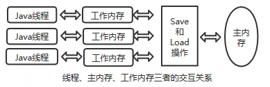

# Java 内存访问模型与线程

一个 Java 程序运行起来就是一个 JVM 进程，JVM 用一个主线程执行 main() 方法，main() 方法内部还可以启动多个线程。此外，JVM 还有负责垃圾回收等其他工作线程。

计算机为解决 CPU 与内存的速度差，引入了基于高速缓存的存储交互设计：每个 CPU 有自己的高速缓存，各高速缓存通过特定的协议与共享的主内存进行读写。但高速缓存也带来了缓存一致性问题。

和线程相关的还有指令重排序：编译器和处理器在不改变单线程语义的前提下调整指令的执行顺序，这会导致多线程程序的实际执行结果与预期不一致。

Java 虚拟机的内存模型（Java Memory Model，JMM）用于屏蔽硬件和操作系统的内存访问差异，让 Java 程序在各种平台上都能获得一致的内存访问效果。

## Java 内存访问模型

Java 内存模型规定，所有的变量都存储在主内存中。每个线程有自己的程序计数器和工作内存。主内存和工作内存是 JMM 的逻辑划分，与堆、栈等运行时内存区域不是同一层面的概念，不能简单地把主内存等同于堆、工作内存等同于栈。

- 主内存：Java 内存模型规定所有的变量都存储在主内存中。
- 工作内存：每个线程都有自己的工作内存，可类比于高速缓存。

线程的工作内存中保存了该线程使用到的变量的主内存副本，线程对变量的所有操作（读取、赋值等）都必须在工作内存中进行，而不能直接读写主内存中的变量。

不同线程之间也无法直接访问对方工作内存中的变量，线程间变量值的传递均需要通过主内存完成。

## Java 内存模型中的操作与规则

Java 内存模型定义了以下作用于主内存和工作内存之间的操作：

- lock（锁定）：作用于主内存的变量，将一个变量标识为被一个线程独占的状态。
- unlock（解锁）：作用于主内存的变量，释放变量，使其可被其他线程锁定。
- read（读取）：作用于主内存的变量，把一个变量的值从主内存传输到工作内存，以便随后的 load 使用。
- load（载入）：作用于工作内存的变量，把 read 从主内存得到的值放入工作内存的变量副本中。
- use（使用）：作用于工作内存的变量，把变量的值传递给执行引擎。虚拟机遇到需要使用变量值的字节码指令时执行此操作。
- assign（赋值）：作用于工作内存的变量，把执行引擎接收到的值赋给工作内存中的变量。虚拟机遇到给变量赋值的字节码指令时执行此操作。
- store（存储）：作用于工作内存的变量，把工作内存中一个变量的值传递到主内存，以便随后的 write 使用。
- write（写入）：作用于主内存的变量，把 store 从工作内存得到的值放入主内存的变量中。

模型对这些操作的规则：

- read 和 load、store 和 write 必须成对出现：read 之后必须 load，store 之后必须 write，不允许其中一个单独出现。
- 线程对某个变量执行过 assign 后，必须随后把结果同步回主内存；未执行过 assign 的变量，不允许将其值 store/write 回主内存。
- 同一时刻一个变量只允许一个线程对其 lock。同一线程可以多次 lock（可重入），lock 与 unlock 必须配对，lock 多少次就要 unlock 多少次，并且只能对本线程 lock 的变量执行 unlock。unlock 之前必须先把该变量的值同步回主内存。

## volatile 的特殊规则

volatile 修饰的变量有两个特性：可见性、禁止指令重排序优化。

- 可见性：一个线程修改 volatile 变量后，该修改对其他线程立即可见。
- 禁止指令重排序：为了充分利用 CPU，当两条机器指令之间没有依赖关系时，处理器可以改变它们的执行顺序，这就叫做乱序执行。volatile 会插入内存屏障指令，禁止这种重排序优化。

JMM 对 volatile 变量定义了特殊的访问规则：

- 对 volatile 变量的 read、load、use 必须连续执行，保证线程每次读取变量都从主内存读到最新值。
- 对 volatile 变量的 assign、store、write 必须连续执行，保证线程每次修改变量都立刻同步到主内存。
- 对同一个 volatile 变量，use/assign 必须与 load/store 保持顺序一致：use 之前必须先执行 load，assign 之后必须随之执行 store。线程对多个 volatile 变量的操作顺序不被重排序打乱。

## synchronized 的内存语义

synchronized 可修饰类的实例方法、静态方法和代码块，归根到底它锁定的资源只有两类：对象和类。从 class 字节码也能看出这一点：实例方法与静态方法通过方法的 flags 标志实现，代码块通过 monitorenter 和 monitorexit 指令实现。

- **原子性**：synchronized 修饰的方法或代码块内，同一时刻只有一个线程执行，其间的操作不会被其他线程打断。volatile 不具备原子性。
- **可见性**：synchronized 和 volatile 都具有可见性。线程获取锁之后才能访问同步区域，释放锁之前会将对变量的修改刷新到主内存，其他线程随后就能读到最新值。锁的状态对其他线程同样可见：某个线程持有锁时，其他线程会在锁池中等待锁释放。
- **有序性**：synchronized 和 volatile 都具有有序性。synchronized 保证每个时刻只有一个线程执行同步代码块，各线程执行同步代码块的先后关系得以确定。

## happens-before 规则

- 程序次序规则：在一个线程中，按照控制流顺序，在前面的操作先行发生于后面的操作。
- 管程锁定规则：一个 unlock 操作先行发生于后面对同一个锁的 lock 操作（"后面"指时间上的先后顺序）。
- volatile 变量规则：对一个 volatile 变量的写操作，先行发生于后面对这个变量的读操作。
- 线程启动规则：Thread 对象的 start() 方法先行发生于此线程的每一个动作。
- 线程终止规则：线程中的所有操作先行发生于此线程的终止检测。
- 线程中断规则：对线程 interrupt() 方法的调用，先行发生于被中断线程的代码检测到中断事件。
- 对象终结规则：一个对象的初始化先行发生于它的 finalize() 的执行。（finalize() 自 JDK 9 起已被标记为废弃，此规则主要为历史完整性而保留。）
- 传递性：A 先行发生于 B，B 先行发生于 C，则 A 先行发生于 C。
